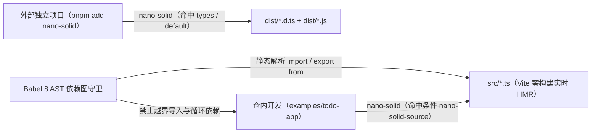

import ExportsResolverDemo from "../../components/ExportsResolverDemo";

到 [9.4](../9.4-vite-plugin/) 为止，`nano-solid` 已经是一个功能完整的细粒度响应式框架 MVP：具备无毛刺调度内核、所有权控制流、原生 JSX 编译器与 Vite 插件。但它目前还有一个致命限制：**只能在当前仓库内部靠私有的 `#nano-solid` 导入使用**。

如果今天你想在另一个全新项目里 `pnpm add nano-solid`，立刻会撞上三堵墙：

1. **没有可发布的库产物与类型声明**：目前的 `vite build` 打包的是演示网页 `index.html`，没有生成供外部项目消费的 `dist/*.js` 与 `dist/*.d.ts`；
2. **没有受控的 `package.json` `"exports"` 白名单**：外部项目不知道从哪里找 `nano-solid`、`nano-solid/jsx-runtime`、`nano-solid/compiler-runtime` 和 `nano-solid/vite`；而如果仓内也改走 `dist/`，改一行框架源码就得先重新构建，Vite 热更新体验会瞬间倒退；
3. **没有自动化的模块边界守卫**：应用代码如果随手绕过公共入口去 import 内部文件，或者模块之间悄悄长出循环依赖，单靠人眼评审迟早失守。

这一章我们把 `nano-solid` 真正做成**可发布、带强类型、带架构守卫的工程级 npm 包**，同时一并把第 9 章刚引入的 Babel 8 AST 能力延伸到依赖图静态分析上：

在下面演示中切换不同的消费环境和导入子路径，先直观体验 `package.json` 的条件 `"exports"` 如何同时做到“仓内直连源码保持热更新、外部 100% 命中 `dist/`、未导出内部文件一律拦截”：

<ExportsResolverDemo label="第十章预期效果：package.json 条件导出解析" client:load />

这一章分四小节完成从库构建到外部项目真实验收的全过程：

- **[10.1 构建库产物与 `.d.ts` 类型声明](../10.1-library-build/)**：分离库构建（`dist/`）与示例页构建（`dist-demos/`），编写 `tsconfig.build.json` 输出 5 个正式入口的 ESM 代码、`.d.ts` 与 source map，并用产物及类型契约测试把公共 API 锁死。
- **10.2 配置 `exports`、仓内源码条件与迁移 Todo**：配置 `package.json` 的 `"exports"` 与 `"files"`，把编译器默认 `runtimeModule` 切为 `"nano-solid/compiler-runtime"`，在 `tsconfig.json` 与 `vite.config.ts` 接入仓内私有条件 `"nano-solid-source"` 保留零构建 HMR，将 `examples/todo-app` 从 `#nano-solid` 迁移到正式包名 `nano-solid`。
- **10.3 基于 Babel AST 的依赖图架构守卫**：复用第 9 章的 `@babel/parser` 与 `@babel/traverse` 实现真正的静态 `import` / `export from` 依赖图分析器，落地跨层依赖拦截与循环依赖检测，为第 11 章的 Todo 分层演进铺平道路。
- **10.4 独立外部项目打包安装验证**：用 `pnpm pack` 打出真实 `.tgz` 压缩包，在临时独立目录中安装 `nano-solid`，跑通 `tsc --noEmit`、Vite `nanoSolid()` 构建与运行时冒烟测试，端到端验证外部消费者体验。
