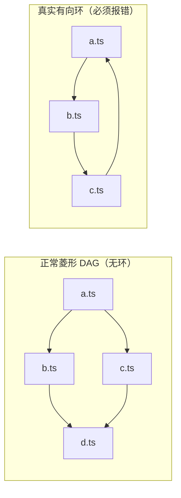
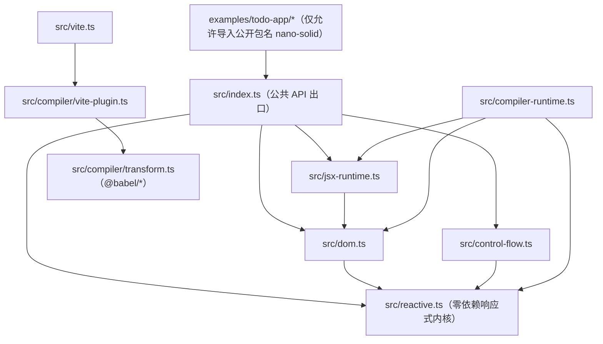

import LessonSolution from "../../components/LessonSolution.astro";

上一节 [10.2](../10.2-package-exports/) 我们靠 `package.json` 的 `"exports"` 挡住了 `import "nano-solid/dist/reactive.js"` 这样的裸包名深层导入。但单靠 `exports` 还有两个盲区：

1. **仓内相对路径绕过**：在 `examples/todo-app/App.tsx` 里写 `import { createSignal } from "../../src/reactive.ts"`，Node 和 TypeScript 都会放行，因为它是合法的文件系统相对路径；
2. **框架内部分层腐化与循环依赖**：如果某天有人不小心在浏览器运行时 `src/dom.ts` 里引入了 `src/compiler/` 或 `@babel/parser`，或者在模块间悄悄形成了 `A -> B -> C -> A` 的循环依赖，等到线上包体积暴涨或运行时出现 `ReferenceError: Cannot access before initialization` 时往往已经积重难返。

好消息是，第 9 章我们已经把整套 Babel 8 AST 工具链（`@babel/parser`、`@babel/traverse`、`@babel/types`）装进了仓库。这一节我们顺手把它升级成真正的**静态依赖图架构守卫（`tools/dependency-graph.ts`）**，用自动化测试把模块边界永久钉死。

## 1. 为什么架构测试必须用 AST，而不能用正则表达式？

很多项目图省事，会用类似 `/from\s+["']([^"']+)["']/g` 的正则去扫导入路径。这种写法在真实代码库里很快就会翻车：

- **注释与字符串误报（False Positives）**：一旦测试夹具、文档注释或错误提示字符串里写了 ``const demo = `import { x } from "../../src/reactive.ts"`;``，正则无法区分代码与字符串，直接报错；
- **多行导入、副作用导入与重导出漏报（False Negatives）**：`import "./polyfill.ts"` 没有 `from`，`export {\n  a,\n  b,\n} from "./x.ts"` 跨越多行，`export * from "./y.ts"` 与动态 `import("./lazy.tsx")` 写法各异，正则越补越脆弱；
- **无法区分运行时导入与纯类型导入**：TypeScript 的 `import type { Todo } from "./types.ts"` 和行内 `import { type Dispose } from "./reactive.ts"` 在编译期就会被彻底擦除，运行时并不产生执行顺序环。只有解析 AST 才能准确读取 `importKind` / `exportKind`。

我们把这套工具放在独立的 `tools/` 目录（并把 `"tools/**/*.ts"` 加入根 `tsconfig.json` 检查），而不放进 `src/`，原因同样明确：`tsconfig.build.json` 只编译 `src/**/*.ts`，仓内工程守卫工具绝不应该混进对外发布的 `dist/` 包产物里。

## 2. 用 Babel 8 AST 提取全部静态依赖边

在 `extractModuleEdges(source, fromFile)` 中，我们开启 `plugins: ["jsx", "typescript"]` 解析 AST，只监听四类标准语法节点：

| AST 节点类型                                                           | 覆盖的源码写法                                         | `kind`             | `typeOnly` 判定规则                                                                                     |
| ---------------------------------------------------------------------- | ------------------------------------------------------ | ------------------ | ------------------------------------------------------------------------------------------------------- |
| `ImportDeclaration`                                                    | `import ... from "x"`、`import "x"`、`import type ...` | `"import"`         | `node.importKind === "type"`，或非空 `specifiers` 全部都是 `importKind === "type"` 的 `ImportSpecifier` |
| `ExportNamedDeclaration`（且 `node.source` 非空）                      | `export { a } from "x"`、`export type { T } from "x"`  | `"export-named"`   | `node.exportKind === "type"`，或非空 `specifiers` 全部都是 `exportKind === "type"` 的 `ExportSpecifier` |
| `ExportAllDeclaration`                                                 | `export * from "x"`、`export type * from "x"`          | `"export-all"`     | `node.exportKind === "type"`                                                                            |
| `ImportExpression`（`source` 为 `StringLiteral`，Babel 8 对齐 ESTree） | `import("./lazy.tsx")`                                 | `"dynamic-import"` | 固定为 `false`（动态加载在运行时求值）                                                                  |

对于 `./` 或 `../` 开头的相对导入，调用 `resolveRelativeModule(fromFile, specifier)` 统一归一化为相对仓库根的正斜杠路径（例如在 `examples/todo-app/App.tsx` 里写 `../../src/reactive.ts`，会立刻还原为 `src/reactive.ts`），后续规则和环检测都只需面对干净的规范化路径。

## 3. 三色 DFS 环检测：为什么不能只用一个 `visited` 集合？

检测有向图里的循环依赖时，初学者常犯的错误是只维护一个 `visited = new Set<string>()`，再次碰到已访问节点就报“发现循环依赖”。这会把最正常的 **菱形无环图（Diamond DAG）** 误报成环：



在左侧菱形图里，DFS 先走 `a -> b -> d` 把 `d` 标记为已访问并回溯；随后走 `a -> c -> d` 时再次遇到 `d`，但 `d` 早就退出当前递归路径了，这里根本没有环！

标准解法是**三色深度优先搜索（3-Color DFS）**：

- **白色（`0`，未访问）**：尚未进入过该节点；
- **灰色（`1`，正在当前递归栈中）**：已经进入但尚未回溯离开。遍历边 `u -> v` 时，**只有当 `v` 是灰色**，才说明沿着当前路径绕回了自己的祖先，构成真正的有向环！此时从当前栈 `stack` 中截取 `v` 到栈顶并补回 `v`，就能精准还原整条环路径；
- **黑色（`2`，已完成）**：该节点及其全部可达后代都已经安全检查完毕，再次遇到直接跳过，既不会误报菱形 DAG，也保证了整张图只遍历每个节点和每条边一次，时间复杂度严格为 `O(V + E)`。

最后，为了避免同一条环从不同起点出发被重复报告（例如 `c -> a -> b -> c` 和 `a -> b -> c -> a` 其实是同一个环），我们把环节点旋转到从字典序最小节点出发，再按字符串键去重排序，保证输出 100% 稳定。

## 4. 为真实仓库立规矩，并为第 11 章留好插槽

目前我们的 `nano-solid` 生产代码已经天然形成一张干净的分层无环图：



我们在 `tools/architecture.test.ts` 中写下了四条声明式规则，外加全仓零循环依赖检查：

- **`reactive-core-zero-dependencies`**：`src/reactive.ts` 保持零依赖；
- **`browser-runtime-no-compiler-or-node-deps`**：浏览器运行时层禁止导入 `src/compiler/*`、`src/vite.ts`、`@babel/*`、`vite` 或 `node:*`；
- **`framework-src-no-upward-deps`**：框架源码 `src/` 禁止反向依赖 `examples/`、`docs/`、`tools/` 或 `vitest`；
- **`examples-only-public-package-entry`**：示例应用禁止相对路径直连 `src/`、禁止残留 `#nano-solid`、禁止深层穿越 `nano-solid/dist/*` 或 `nano-solid/src/*`。

到了第 11 章，当我们把 Todo 应用拆分成领域类型、持久化接口、Store、展示组件和适配器层时，只需往这份规则数组里追加几条声明式规则，整套 AST 依赖图守卫立刻就能继续护航应用架构！

> [!PRACTICE]
>
> ```sh
> git switch -c solve/10.3 10.3-learn
> ```
>
> 本节已把 `tools/**/*.ts` 加入 `tsconfig.json`，搭建了 `tools/dependency-graph.ts` 的类型与函数骨架，并在 `tools/architecture.test.ts` 新增了 5 条 `it.skip` 测试，覆盖 Babel AST 边提取、三色 DFS 环检测、规则引擎违例报告以及对本仓库真实生产源码的边界与零环验收。补齐 `extractModuleEdges`、`buildDependencyGraph`、`findCycles` 与 `checkArchitectureRules`，运行 `pnpm format && pnpm check && pnpm test:run`，确认全部 154 条测试通过。

<LessonSolution slug="10.3-ast-architecture-guard" tag="10.3-solution" />
