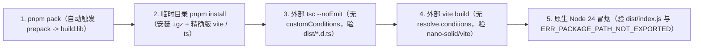

import LessonSolution from "../../components/LessonSolution.astro";

到 [10.3](../10.3-ast-architecture-guard/) 为止，我们在本仓库里的所有测试、类型检查、依赖图守卫与双构建都已经全绿。但任何一个做过开源库发布的工程师都知道：**在自己仓库里全绿，不等于别人 `pnpm add` 你的包就能跑通**。

这一节我们给 `nano-solid` 加上发布前最后一道、也是最接近真实世界的防线：**用 `pnpm pack` 打出真实 `.tgz` 压缩包，在仓库之外的干净临时目录里安装并验收**。

## 1. 为什么在自己仓库里“全绿通过”，发出去仍可能翻车？

本仓库里有四重“温室效应”，会悄悄掩盖发布事故：

1. **仓内源码条件掩盖坏掉的 `dist/`**：我们的根 `tsconfig.json` 和 `vite.config.ts` 都开启了 `"nano-solid-source"`，平时写代码一直直接读 `src/*.ts`。万一某个子路径的 `"types"` 或 `"default"` 路径拼错，仓内测试完全察觉不到；
2. **`devDependencies` 幽灵依赖**：本仓的 `node_modules` 里装了 `vitest`、`jsdom`、`oxlint` 等全部开发依赖。如果框架代码不小心在运行时引用了某个 `devDependency`（或者漏把 `@babel/*` 放进 `dependencies`），本仓跑得好好的，外部项目一装就报 `ERR_MODULE_NOT_FOUND`；
3. **过期 `dist/` 被误发**：如果你改了 `src/` 却忘了重新运行 `pnpm build:lib`，直接 `pnpm pack` 会把上次留下的旧 `dist/` 打进包里。在 `package.json` 加上 `"prepack": "pnpm run build:lib"` 生命周期脚本后，每次 `pnpm pack` 或 `pnpm publish` 前都会自动重新构建最新 `dist/`；
4. **`files` 白名单遗漏或泄露**。解开 `pnpm pack` 产出的 `.tgz`，检查包里是否有 `package.json`、`README.md`、`LICENSE` 和完整的 `dist/` 产物。`pnpm pack` 会自动带上说明和许可证。源码、示例、仓库工具和测试文件留在仓库里。

## 2. 为什么外部验收项目必须建在仓库之外的 `os.tmpdir()`？

写打包验收脚本时，一个特别容易踩的坑是在仓库目录下建一个 `./tmp/consumer` 文件夹。

Node.js、TypeScript 和 Vite 解析模块时都会**逐层向上查找父目录的 `node_modules` 与 `tsconfig.json`**。如果临时项目还留在仓库目录里面，即使外部项目的依赖漏装了某个包，解析器也会一路向上爬进我们仓库的根目录 `node_modules` 把它“借”来用，测试假绿！

用 `mkdtempSync(join(tmpdir(), "nano-solid-consumer-"))` 把临时项目建在操作系统临时目录下，才能在文件系统层面彻底切断与本仓库的任何继承关系，100% 模拟陌生用户的机器环境。

## 3. 在临时项目中跑完验收

在 `tools/verify-package.ts` 中，我们把整个外部验收做成既能被 Vitest 自动跑、又能通过 `pnpm run verify:pack` 单独执行的流水线：



实现时有两处实用的工程细节：

- **复用安装缓存**。用 `readInstalledVersion` 读出本仓库已经安装的 `typescript` 和 `vite` 的精确版本，写进临时项目的 `package.json`，然后在临时的 `pnpm-workspace.yaml` 中允许 `esbuild` 的安装脚本。本地用 `--offline` 复用已有缓存。CI 第一次运行时缓存可能还不齐，用 `--prefer-offline` 优先读取缓存，缺的再下载。
- **严格不带任何仓内后门**：临时项目的 `tsconfig.json` 只写标准用户的 `"jsx": "react-jsx"` 与 `"jsxImportSource": "nano-solid"`（**不写 `customConditions`**）；`vite.config.ts` 直接 `import { nanoSolid } from "nano-solid/vite"`（**不写 `resolve.conditions`**）；最后 `finally` 中务必清理临时目录不留垃圾。

这一步跑通以后，`nano-solid` 就从头到尾完成了作为独立前端框架 MVP 的所有工程环节：细粒度响应式内核、所有权与控制流、JSX 编译器与 Vite 插件、库构建与条件导出、Babel AST 架构守卫，以及真实的外部项目安装验收。下一章（第 11 章），我们将以**正式外部消费者视角**，把 Todo 应用演进为带持久化、Store 与组件分层、并由本章 AST 守卫护航的完整实战应用！

> [!PRACTICE]
>
> ```sh
> git switch -c solve/10.4 10.4-learn
> ```
>
> 本节已在 `package.json` 补上 `prepack` 与 `verify:pack` 脚本，搭建了 `tools/verify-package.ts` 的骨架，并在 `src/package-build.test.ts` 新增 2 条 `it.skip` 测试（覆盖 `.tgz` 白名单纯净度与独立外部项目全链路验收）。补齐 `packPackageTarball` 与 `verifyExternalConsumer`，运行 `pnpm format && pnpm check && pnpm test:run && pnpm run verify:pack`，确认全部 156 条测试与独立外部项目验收全部通过。

<LessonSolution slug="10.4-external-consumer-verify" tag="10.4-solution" />
