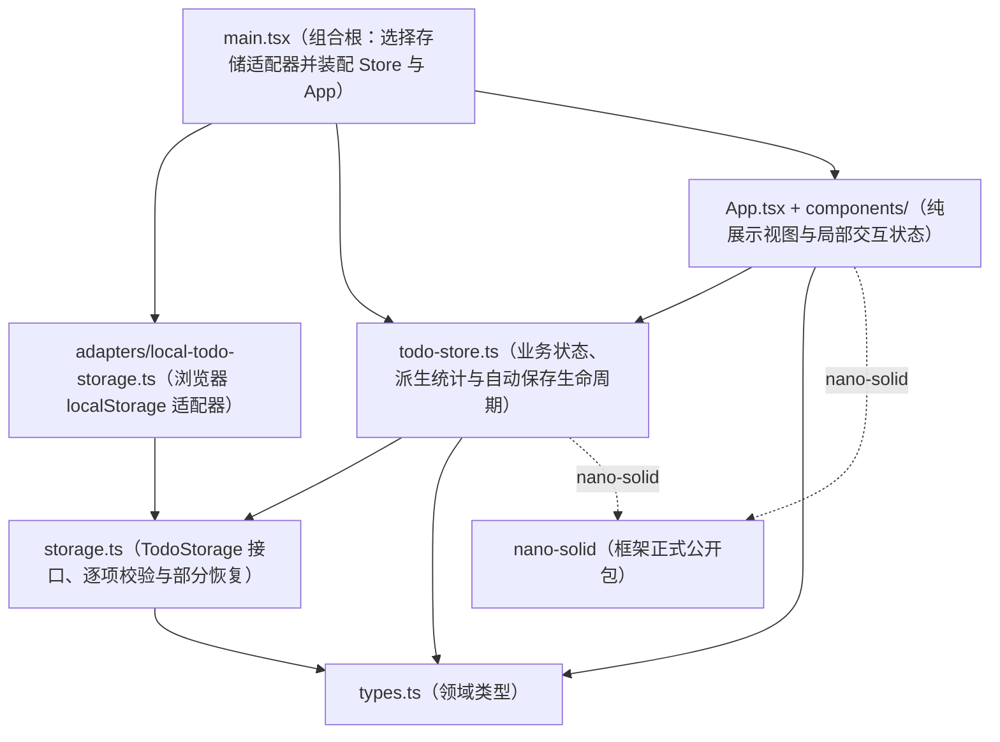

import PersistentTodoDemo from "../../components/PersistentTodoDemo";

到 [10.4](../10.4-external-consumer-verify/) 为止，`nano-solid` 已经正式成为可打包、带类型声明、带 Vite JSX 编译器插件且有 Babel AST 依赖图守卫的独立前端框架包，`examples/todo-app/` 也已经像外部项目一样通过 `"nano-solid"` 消费它。

现在我们把镜头切回应用工程本身。翻开目前的 `examples/todo-app/App.tsx`，你会看到两个典型的“原型期债务”：

1. **刷新即清空，也没有任何故障容错**：任务只存在内存里的 `createSignal`，刷新页面就归零；如果直接往组件里塞 `localStorage.getItem / setItem`，一旦遇到损坏 JSON、重复 ID 或浏览器隐私模式配额报错，页面就会直接崩溃，测试也极难覆盖；
2. **状态逻辑、副作用与 280 行 JSX 全部耦合在单个文件里**：想要单测“新增任务并自动保存”“写入失败时保留内存状态并展示降级提示”这类业务规则，被迫每次都渲染整棵 DOM 树；而组件越写越长，越容易悄悄反向依赖 `window.localStorage` 或跨层互相拉扯。

这一章我们就基于正式发布的 `nano-solid` 包与第 10 章刚落地的 Babel AST 依赖图守卫，按清晰的自底向上分层把 Todo 应用彻底重构干净：

先体验一下这一章的终点效果。试着在上半区添加或勾选一条任务，再点 **重新打开演示**（会真实卸载并重挂载组件）确认状态已保存；再点击下半区的故障演练按钮，观察损坏数据部分恢复与写入失败时的降级提示：

<PersistentTodoDemo label="第十一章预期效果：Todo 持久化与故障降级演示" client:load />

这一章分四小节把整套分层架构落地，并且保证每一步都继续跑在第 9 章的 JSX 编译器之上：

- **[11.1 领域模型与带容错校验的 `TodoStorage` 接口](../11.1-storage-and-validation/)**：拆出 `types.ts`、`storage.ts`（定义 `TodoStorage` 接口与逐项校验 `parseTodos` / `loadTodosFromStorage`）、浏览器适配器 `adapters/local-todo-storage.ts` 与内存测试替身，搞定损坏数据部分恢复、重复 ID 去重与读写故障降级。
- **[11.2 把状态与持久化收敛进可单测的 `createTodoStore`](../11.2-todo-store/)**：抽离 `todo-store.ts`，用 `Owner` 统一管理自动保存与派生统计的生命周期（首次水合跳过白写、写入只追踪 `todos()`、保存失败不丢内存改动并展示提示），在无 DOM 的 `createRoot` 中毫秒级验证全部业务规则。
- **[11.3 拆分 5 个纯展示组件并用 `App.tsx` 组装](../11.3-components-and-composition/)**：拆出 `PersistenceBanner`、`TodoComposer`、`TodoFilters`、`TodoItem`、`TodoList` 五个职责单一的子组件，让 `App.tsx` 退回薄壳视图并在 `main.tsx` 完成依赖注入装配，端到端通过全部持久化与交互测试。
- **11.4 将 Todo 分层边界接入依赖图守卫**：复用第 10 章的 `tools/dependency-graph.ts`，把 Todo 每一层“允许依赖谁”写成一张白名单表，由通用的 `createLayerRule` 生成架构规则，让前三节的分层决定变成每次 `pnpm test:run` 都会执行的检查。
