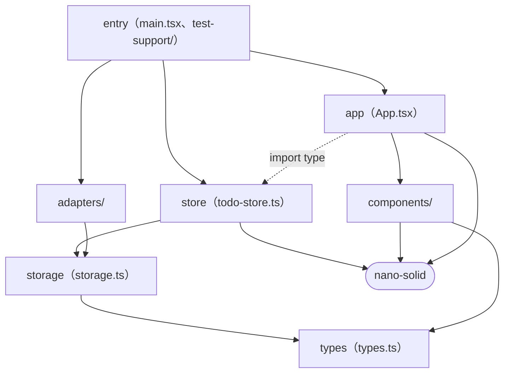

import LessonSolution from "../../components/LessonSolution.astro";

经过 [11.1](../11.1-storage-and-validation/) 到 [11.3](../11.3-components-and-composition/)，Todo 应用已经分成了类型、存储协议、存储实现、Store、组件、根视图和组合根几层。可这些边界目前只存在于我们的脑子和课程正文里。哪天有人在 `TodoList.tsx` 里顺手 `import { createLocalTodoStorage } from "../adapters/local-todo-storage.ts"`，类型检查会通过，测试也会通过，分层就悄悄塌了一角。

[10.3](../10.3-ast-architecture-guard/) 已经写好了基于 Babel AST 的依赖图和规则引擎，用它守住了框架内核的边界。这一课给它加一个通用能力 `createLayerRule`，再用一张表把 Todo 的分层写成可执行的规则。

## 1. Todo 的分层长什么样

先画出前三节里决定的几条依赖方向。实线箭头表示“允许依赖”，虚线只允许 `import type`。完整的许可在后面的白名单里。



- `storage.ts` 的解析和校验都是纯函数，换一个框架也能原样复用。11.1 的测试可以直接调用这些函数。
- `adapters/` 只依赖 `storage.ts` 和 `types.ts`。它实现 `TodoStorage` 协议，供组合根选用。
- `components/` 通过 Props 拿数据和回调。这样 11.3 的测试就能在组合根换用内存存储，界面代码照常运行。
- `App.tsx` 通过类型导入知道 `TodoStore` 长什么样，具体的 Store 由组合根传入。
- 只有组合根 `entry` 能把具体实现接到一起。

## 2. 为什么用白名单，而不是继续写“禁止”规则

第 10 章的 4 条规则都是黑名单写法：“`src/` 禁止依赖 `examples/`”“浏览器运行时禁止依赖 `@babel/*`”。框架只有两三个层次，这么写很直观。到了 Todo，有 7 个层，黑名单就暴露出两个问题。

7 个不同的层之间就有 42 种导入方向。细到每对层都去列禁令，表会很长，也容易漏掉一条本该拦住的依赖。

新增的东西默认也会被放行。下周有人加了一个 `services/` 目录，现有禁令可能都没提到它。

白名单只放行表里列出的依赖。上面图里的箭头都能在这张表里找到。

```ts
const TODO_APP_LAYERS = {
  types: [],
  storage: ["types"],
  adapters: ["storage", "types"],
  store: ["storage", "types", "nano-solid"],
  components: ["components", "types", "nano-solid"],
  app: ["components", { layer: "store", typeOnly: true }, "types", "nano-solid"],
  entry: ["entry", "app", "store", "adapters", "storage", "types", "nano-solid"],
} satisfies Record<string, readonly LayerDependency[]>;
```

这张表同时也是架构文档。普通文档写完就开始过期，这张表每次 `pnpm test:run` 都会和真实代码对一遍，代码变了它要么跟着改，要么测试失败。

> [!NOTE]
> 同一层内部互相依赖也要显式写出来，比如 `components` 列表里有 `components`，因为 `TodoList` 要渲染 `TodoItem`。`types` 只有一个文件，就不需要。显式写出来的好处是，哪天有人想让 `adapters/` 之间互相调用，他得先改这张表，这个决定就会出现在代码评审里。

## 3. 只守 import 边，不守全局 API

组件也能直接写 `window.localStorage.setItem(...)`。我们这次检查的是模块之间的依赖，这种调用不在依赖图里。

`extractModuleEdges` 从 AST 里找静态导入、重导出和使用字符串字面量的 `import()`。要检查全局 API，还得处理局部变量是否遮蔽了全局变量、`const w = window` 这样的别名，以及 `globalThis["local" + "Storage"]` 这样的计算属性。

11.3 的测试仍有用。比如测试期待任务保存到注入的内存存储，界面如果只写了浏览器存储，这条断言就会失败。

## 4. 外部包也是一层

表里的 `nano-solid` 不是仓库里的目录，而是外部包名。`createLayerRule` 判断依赖目标所在的层时分两种情况：

- 相对路径导入（`resolvedTo` 不为 `null`）：交给 `classify` 求出目标文件所在的层；
- 裸包名导入：直接用包名当层名。`"nano-solid"` 的层名就是 `nano-solid`，作用域包 `"@scope/pkg/sub"` 取前两段 `@scope/pkg`。

这样“`storage.ts` 不依赖框架”就不再是一句约定。哪天有人在 `storage.ts` 里 import 了 `createSignal`，`storage` 层的白名单里没有 `nano-solid`，守卫会直接报出来。同理，`types` 层的白名单是空数组，它不能依赖任何东西，包括任何第三方包。

## 5. `import type` 算不算依赖

`App.tsx` 需要 `TodoStore` 这个类型来声明 Props，但它不该在运行时依赖 `todo-store.ts`。

有人会说类型导入在编译后会被擦除，干脆不算依赖。这不对。`TodoStore` 的形状一改，`App.tsx` 就得跟着改，这是实打实的耦合。10.3 的环检测测试用的也是 `includeTypeOnly: true`，类型环同样会让模块之间纠缠不清。

所以白名单里的许可分两种：写字符串 `"store"` 表示允许任意导入，写 `{ layer: "store", typeOnly: true }` 表示只允许 `import type`。`App.tsx` 拿到的是后者，它可以知道 Store 的形状，却拿不到 `createTodoStore` 这个值。`extractModuleEdges` 在 10.3 就已经为每条边标好了 `typeOnly`，这里直接用。

## 6. 没归层的文件怎么办

`classify` 对不认识的文件返回 `null`，这会出现在两个位置：

- 依赖目标没归层：比如组件用相对路径 import 了 `src/` 里的框架源码，或者 import 了一个新建但还没归层的文件。这算违例，规则会报“未归入任何层”。
- 来源文件没归层：规则不约束它。这个默认值是为了让同一套规则引擎能用在任何子集上，代价是新文件可能悄悄逃出约束。

第二种情况由测试补上：在检查依赖之前，先断言 `examples/todo-app` 下每个生产文件都能被 `classifyTodoFile` 归层。新增文件时，你必须先决定它属于哪一层，这正是我们想强迫自己做的决定。

## 7. 动手实现 `createLayerRule`

起始代码在 `tools/dependency-graph.ts` 中新增了两个类型和一个函数骨架：

```ts
export type LayerDependency = string | { layer: string; typeOnly: true };

export type LayerRuleOptions = {
  name: string;
  classify: (file: string) => string | null;
  allow: Readonly<Record<string, readonly LayerDependency[]>>;
};

export function createLayerRule(options: LayerRuleOptions): ArchitectureRule;
```

它返回 10.3 已有的 `ArchitectureRule`，可以直接交给 `checkArchitectureRules`。规则按下面的顺序检查依赖。

- `matchFrom`：来源文件能被 `classify` 归层才受约束；
- 求目标层：相对路径交给 `classify`，裸包名取包名（作用域包取前两段）；
- 目标层为 `null`：报“未归入任何层”；
- 在来源层的白名单里找许可，找不到就报越层；找到的是 `typeOnly` 许可但这条边不是纯类型导入，报“只能用 `import type`”。

`tools/architecture.test.ts` 里已经写好了 `classifyTodoFile`、`TODO_APP_LAYERS` 和 2 条被跳过的测试。第一条用一张和 Todo 无关的小分层表覆盖所有分支，第二条检查真实的 Todo 源码。

测试通过后，可以临时在 `examples/todo-app/components/TodoList.tsx` 里导入 `../adapters/local-todo-storage.ts`，看看报错能否指到这行。试完把导入删掉。

> [!PRACTICE]
>
> ```sh
> git switch -c solve/11.4 11.4-learn
> ```
>
> 实现 `createLayerRule` 后，“分层白名单规则”下的两条测试应当通过。
>
> ```sh
> pnpm format && pnpm check && pnpm test:run
> ```

<LessonSolution slug="11.4-todo-architecture-guard" tag="11.4-solution" />
