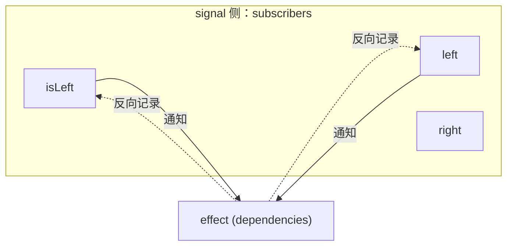
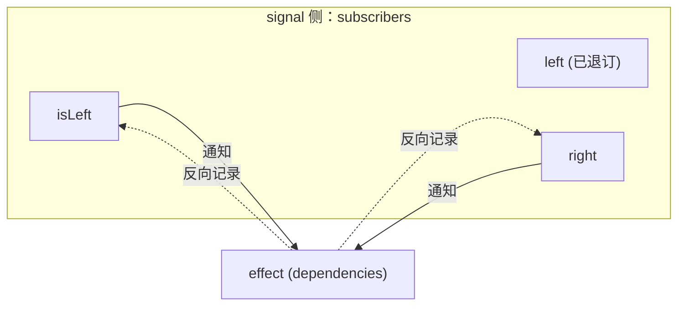

import EffectLifecycleDemo from "../../components/EffectLifecycleDemo";
import LessonSolution from "../../components/LessonSolution.astro";

[3.1](../3.1-same-value/) 拦住了对同一个 signal 重复写入相同值的情况。但就算每次写入都是新值，effect 还是可能被已经用不到的 signal 误伤。来看这段带条件分支的代码：

```ts
const [isLeft, setIsLeft] = createSignal(true);
const [left, setLeft] = createSignal(0);
const [right, setRight] = createSignal(10);

createEffect(() => console.log(isLeft() ? left() : right()));

setIsLeft(false);
setLeft(1);
setRight(11);
```

首次执行时 `isLeft()` 为 `true`，回调读了 `isLeft` 和 `left`，打印 `0`。接着 `setIsLeft(false)` 把分支切到 `right`，回调改读 `isLeft` 和 `right`，打印 `10`。按理说现在 `left` 已经不在执行路径里了，可紧接着调用 `setLeft(1)`，Console 却多打印了一次 `10`。

原因在[第二章](../2.0-reactivity/)留下的单向结构里：每个 signal 只管往自己的 `subscribers` 里 `add`，从来没有地方把旧订阅删掉。`left` 并不知道 effect 已经不再读它了。

## 从单向订阅到双向记录

要把 effect 从上一轮读过的 signal 里退订，靠目前的数据结构办不到。现在只有 signal 认识 effect，effect 并不知道自己曾登记在哪些 signal 的 `subscribers` 里。

解决办法是把单向关系改成双向记录：

- **signal 侧**仍然维护 `subscribers: Set<Effect>`，用来在写入新值时通知依赖它的 effect。
- **effect 侧**不再只是一个裸函数，而是一个对象，额外带上 `dependencies: Set<Set<Effect>>`，保存它上一轮登记过的所有 `subscribers` 集合引用。

首次执行完 `isLeft() ? left() : right()` 时，依赖图长这样（实线表示 signal 持有订阅者，虚线表示 effect 记下的反向引用）：



接下来每次 `runEffect(effect)` 启动时，先做一次清理：遍历 `effect.dependencies`，把 `effect` 从每个 `subscribers` 里删掉，再清空 `effect.dependencies`。然后重新执行 `effect.callback()`，本轮实际调用到的 `get()` 会把新的双向关系重新建起来。

调用 `setIsLeft(false)` 完成清理和重跑后，依赖图就会变成这样：



现在 `left` 的 `subscribers` 里已经没有这个 effect 了，之后再调用 `setLeft(1)` 不会再把它唤醒。

## 为什么遍历 `subscribers` 前要先复制快照？

引入“重跑前先退订、重跑时再重新订阅”后，还会顺带撞上一个 JavaScript `Set` 的经典坑。

假设 `setIsLeft(false)` 直接写 `for (const subscriber of subscribers) { runEffect(subscriber); }`：

1. `for...of` 取出 `effect`，进入 `runEffect(effect)`。
2. `cleanupDependencies(effect)` 把 `effect` 从 `isLeft` 的 `subscribers` 里删掉。
3. `effect.callback()` 马上又读了一次 `isLeft()`，`get()` 把 `effect` 重新 `add` 回同一个 `subscribers`。
4. 按照 JavaScript 规范，在遍历 `Set` 的过程中被删除后又重新加入的元素，会被当作新元素再次访问。循环永远走不到头，进程直接卡死。

为了避免你在练习时把终端跑死，`3.2-learn` 的起手代码已经在 `set(next)` 里把遍历改成了先复制一份本轮快照：

```ts
for (const subscriber of Array.from(subscribers)) {
  runEffect(subscriber);
}
```

快照里只包含写入发生那一刻的订阅者列表，执行过程中对原 `subscribers` 的删减和重新登记，都不会再干扰这一轮循环。

## 预期效果

点下面的 `setIsLeft(false)`，Console 打印 `10`。再点 `setLeft(1)`，代码框追加了调用，但 Console 纹丝不动。只有点 `setRight(11)` 时，Console 才会打印 `11`。

<EffectLifecycleDemo
  mode="dynamic-deps"
  codeHeight="16rem"
  label="3.2 预期效果：切换分支后旧分支不再触发更新"
  client:load
/>

> [!PRACTICE]
>
> ```sh
> git switch -c solve/3.2 3.2-learn
> ```
>
> 起手运行 `pnpm dev` 会打印 `0`、`10`、`10`、`11`（`setLeft(1)` 多触发了一次旧分支重跑）。补齐 `src/reactive.ts` 中的反向登记与清理逻辑，让 `pnpm dev` 只打印 `0`、`10`、`11`，并确保 `pnpm format && pnpm check && pnpm test:run` 全部通过。

<LessonSolution slug="3.2-dynamic-dependencies" tag="3.2-solution" />
