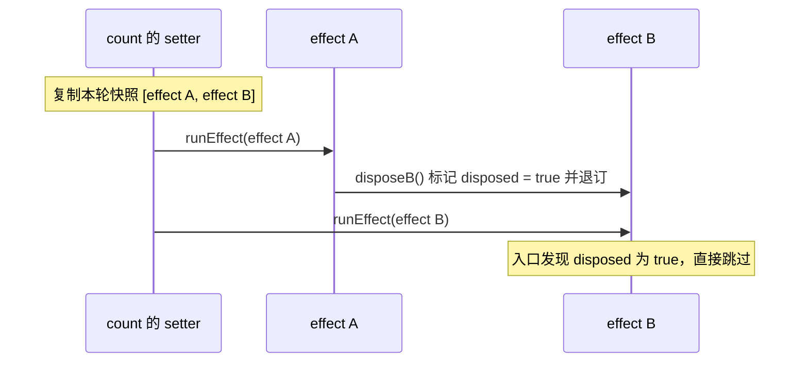

import EffectLifecycleDemo from "../../components/EffectLifecycleDemo";
import LessonSolution from "../../components/LessonSolution.astro";

[3.2](../3.2-dynamic-dependencies/) 让 effect 在每次重跑前自动退订不再读取的旧分支。但在实际应用里，我们还需要一种办法把整个 effect 彻底停掉。比如一个弹窗关闭了、一条列表项被移除了，绑在上面的 effect 如果不释放，就会一直留在 signal 的 `subscribers` 里，既白跑逻辑又泄漏内存。

在 `nano-solid` 中，我们让 `createEffect` 返回一个释放函数 `dispose: Dispose`：

```ts
const [count, setCount] = createSignal(0);

const dispose = createEffect(() => console.log(count()));
setCount(1);
dispose();
setCount(2);
```

调用 `dispose()` 后，这个 effect 会断开自己持有的所有订阅。之后的 `setCount(2)` 照常更新 `count` 的值，但不再唤醒它。多次调用 `dispose()` 也应该是安全的空操作。

## 为什么只做 `cleanupDependencies` 还不够？

[3.2](../3.2-dynamic-dependencies/) 已经写好了 `cleanupDependencies(effect)`，表面看似乎在 `dispose()` 里调一下它就够了。但结合 [3.2](../3.2-dynamic-dependencies/) 的快照遍历机制，有两个边界必须靠 `effect.disposed` 标记兜住：

1. **同一轮通知快照里被前面的 effect 释放**：`set(next)` 在通知前会用 `Array.from(subscribers)` 复制一份快照。假设 `effect A` 和 `effect B` 都订阅了 `count`，当 `setCount(1)` 先跑 `effect A` 时，`effect A` 调用了 `disposeB()`。虽然 `effect B` 已经从原 `subscribers` 里移除，但它依然躺在当前循环的快照里。紧接着 `runEffect(effect B)` 被调用时，入口必须先检查 `effect.disposed` 并直接返回。
2. **effect 在回调中途释放了自己**：如果一个 effect 在回调里调用了自己的 `dispose()`，紧接着又读了某个 signal，此时 `currentEffect` 还没在 `finally` 里恢复。如果不检查 `currentEffect.disposed`，这次读值就会把已经释放的 effect 重新塞回 `subscribers`，留下清理不掉的僵尸引用。所以在 `get()` 里发现 `currentEffect.disposed` 为 `true` 时，直接返回 `value` 跳过登记。

下面这张时序图展示了第一种情况：为什么即便 `disposeB()` 已经退订，依然要在 `runEffect` 入口拦住已经进入快照的 `effect B`：



> [!NOTE]
> 这里抽出来的内部辅助函数 `disposeEffect(effect)` 也会在下一节派上用场：当回调读完部分 signal 后抛错时，直接复用它清理半截订阅。

## 预期效果

先点一两次 `调用 setCount(...)`，确认 Console 正常打印新值。接着点 `调用 dispose()`，再继续点 `调用 setCount(...)`，代码区继续追加写入调用，但 Console 不会再出现新日志。

<EffectLifecycleDemo
  mode="dispose"
  label="3.3 预期效果：调用 dispose() 后停止响应更新"
  client:load
/>

> [!PRACTICE]
>
> ```sh
> git switch -c solve/3.3 3.3-learn
> ```
>
> 起手运行 `pnpm dev` 会打印 `0`、`1`、`2`（`dispose()` 还没有真正断开订阅）。补齐 `src/reactive.ts` 中的 `disposeEffect` 以及 `runEffect`、`get` 的释放守卫，让 `pnpm dev` 只打印 `0`、`1`，并确保 `pnpm format && pnpm check && pnpm test:run` 全部通过。

<LessonSolution slug="3.3-dispose" tag="3.3-solution" />
