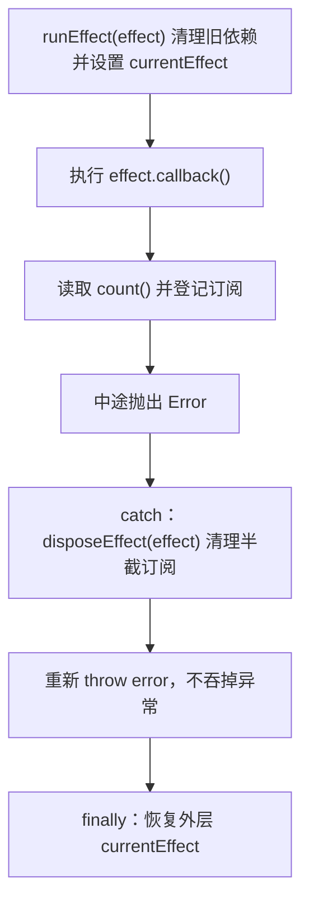

import LessonSolution from "../../components/LessonSolution.astro";

在 [2.3](../2.3-track-effects/) 里我们用 `try / finally` 保证了回调抛错后 `currentEffect` 会恢复原状。但还有一种更隐蔽的泄漏：如果回调在抛错**之前**已经读了某个 signal，会怎么样？

```ts
const [count, setCount] = createSignal(0);

try {
  createEffect(() => {
    const current = count();
    console.log("effect run:", current);
    throw new Error("boom");
  });
} catch (error) {
  console.log("caught:", (error as Error).message);
}

setCount(1);
```

执行到 `count()` 时，`get()` 已经把这个 effect 登记进了 `count` 的 `subscribers`。紧接着 `throw new Error("boom")` 打断了 `createEffect`：`finally` 确实把 `currentEffect` 恢复成了 `undefined`，但 `count` 里的订阅并没有被撤销。

更麻烦的是，因为 `createEffect` 根本没有正常返回，调用方连 `dispose` 句柄都拿不到。这个半残的 effect 就这样永久挂在了 `count` 上，之后每次调用 `setCount(1)` 都会把它重新唤醒，再把调用方炸一遍。

## 用 `catch` 复用 `disposeEffect`

重跑中途抛错也一样：先执行了 `cleanupDependencies(effect)`，接着回调读到第一个 signal 重新建立了订阅，然后在下一行抛错。如果不做清理，这个半截订阅也会一直残留。

解决办法非常直接，[3.3](../3.3-dispose/) 已经为我们准备好了现成的 `disposeEffect(effect)`。只需要在 `runEffect` 的 `try` 和 `finally` 之间补上一个 `catch (error)`：



这里有两点必须同时做到：

1. **清理半截订阅**：调用 `disposeEffect(effect)`，既把 `effect.disposed` 标为 `true`，又把本轮抛错前已经挂上的所有 signal 订阅全部退订。
2. **不要吞掉异常**：清理完以后立刻 `throw error`，让调用方照常感知到回调里发生的错误。随后 `finally` 依然会执行，把外层的 `currentEffect` 恢复原样，不会影响外层嵌套 effect 继续追踪自己的依赖。

> [!NOTE]
> 有人会问：抛错后直接 `disposeEffect` 会不会太严格，万一以后数据恢复正常了呢？在没有错误边界（Error Boundary）机制的最小响应式内核里，保留一个处于未知半截状态的 effect 往往会在无关写入时反复抛错，且首次失败时外部根本拿不到 `dispose`。自动释放再由上层决定是否重建，是更可控的默认行为。

> [!PRACTICE]
>
> ```sh
> git switch -c solve/3.4 3.4-learn
> ```
>
> 起手运行 `pnpm dev` 会打印 `effect run: 0`、`caught: boom`，随后在 `setCount(1)` 时再次打印 `effect run: 1` 和 `setCount(1) failed: boom`。补齐 `src/reactive.ts` 中 `runEffect` 的异常清理逻辑，让 `pnpm dev` 只打印 `effect run: 0`、`caught: boom`、`setCount(1) ok`，并确保 `pnpm format && pnpm check && pnpm test:run` 全部通过。

<LessonSolution slug="3.4-throw-cleanup" tag="3.4-solution" />
