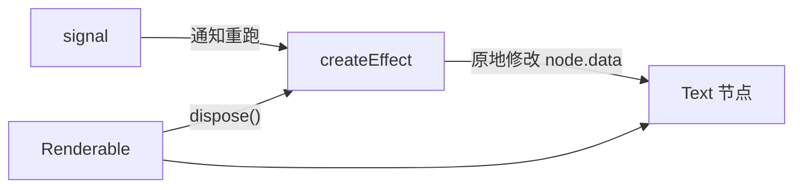

import LessonSolution from "../../components/LessonSolution.astro";

在 [4.1](../4.1-browser-vite/) 里，我们每次想让页面上的某个数字跟着 signal 变，都要先查出 DOM 元素，再手写一段 `createEffect` 去改 `element.textContent`，最后还得单独记下 `disposeEffect`。如果一个段落里同时有一段固定文案和一个动态数字（比如 `"当前计数："` + `count()`），直接改父元素的 `textContent` 还会把整个段落里的所有子节点一起清掉重来。

真正细粒度的做法，是把动态变化的那一小块文字做成一个独立的原生 `Text` 节点：只在创建时挂进 DOM 一次，之后每当 signal 变化，只原地修改这个 `Text` 节点的 `.data` 属性。

## 把节点和清理打包成 `Renderable`

从这一节起，我们新建 `src/dom.ts` 放 DOM 渲染器代码。先准备三个薄封装原语：`createElement`、`createText`、`mount`，再定义一个贯穿整章的核心类型 `Renderable`：

```ts
export type Renderable<T extends Node> = {
  node: T;
  dispose: Dispose;
};
```

为什么不直接返回 `Text`，非要包一层 `{ node, dispose }`？因为响应式节点一旦建立，就会向 signal 注册订阅。把 DOM 节点和它的释放函数绑在一起返回，调用方（以及下一节的父元素）就能顺着同一份结构既完成挂载，又完成清理。



## 原地更新同一个 `Text` 节点

`createReactiveText(getValue)` 的职责非常聚焦：

1. 先用 `createText("")` 创建一个空 `Text` 节点。
2. 立刻用 `createEffect(() => { node.data = getValue(); })` 跑第一次计算，把初始文本写进 `node.data`，同时自动追踪 `getValue()` 内部读到的所有 signal。
3. 把 `{ node, dispose }` 返回给调用方。

因为 [3.3](../3.3-dispose/) 已经保证了 `createEffect` 返回的 `dispose` 是幂等的，调用 `binding.dispose()` 一次或多次都会安全断开订阅，文本内容会停留在释放前的最后一次值。

> [!NOTE]
> 在这一节的最后一条测试里可以看到：把节点从 DOM 移走（`parent.remove()`）和调用 `binding.dispose()` 目前还是两步分开的操作。如果不调 `dispose()`，被移走的 `Text` 节点虽然已经看不见了，但只要有闭包引用着它，背后的 effect 依然会在每次写入时白跑。4.3 和 4.4 会把节点树和挂载卸载彻底收口起来。

> [!PRACTICE]
>
> ```sh
> git switch -c solve/4.2 4.2-learn
> ```
>
> 起手运行 `pnpm dev` 打开页面可以看到计数显示 `0`，但点击 `+1`、`-1`、`重置` 后数字不会变化（因为起手代码只赋值了一次，还没有用 `createEffect` 订阅）。补齐 `src/dom.ts` 中的 `createReactiveText`，让页面恢复实时更新，并确保 `pnpm format && pnpm check && pnpm test:run && pnpm build` 全部通过。

<LessonSolution slug="4.2-reactive-text" tag="4.2-solution" />
