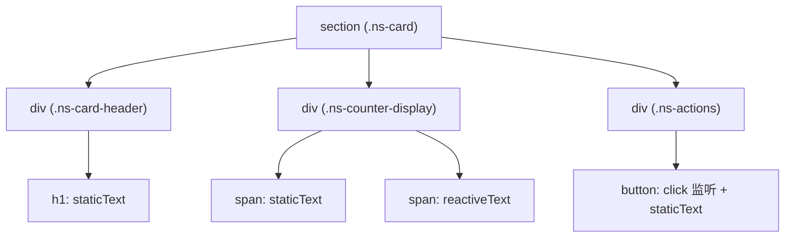

import LessonSolution from "../../components/LessonSolution.astro";

[4.2](../4.2-reactive-text/) 让我们拿到了独立的响应式文本节点，但真实的页面不可能只有一个 `Text` 节点。一个最简单的计数器卡片里，就混合了标题、标签、动态数字和三个按钮。如果每个响应式节点和按钮监听都要靠外层手工记一个 `dispose` 数组，嵌套只要超过两层，漏掉一处清理几乎是必然的。

这一节我们把静态文本和元素节点全部统一成同一种 `Renderable<Node>` 结构，让整棵 DOM 树的**挂载**和**释放**沿着父子关系自动传播。

## 用同一套接口表示所有节点

在 `src/dom.ts` 里新增两个函数：

- `createStaticText(value)`：把普通静态文本也包成 `{ node, dispose: () => {} }`。虽然它自己没有订阅，但统一成 `Renderable<Text>` 后，就能和 `createReactiveText` 毫无差别地塞进同一个 `children` 数组。
- `createRenderableElement(tag, children)`：创建对应的 HTML 元素，依次把 `children` 里的 `child.node` 挂进去，并返回一个会依次调用 `child.dispose()` 的释放函数。

因为子元素本身也可能是一个 `createRenderableElement`，调用根节点的 `dispose()` 时，清理会自动沿着整棵树递归到底层每一个响应式文本和事件监听：



## 离开手写 HTML 骨架

从这一节起，根目录 `index.html` 只留下一个空的 `<main id="app"></main>`，整个计数器界面完全由 `src/main.ts` 调用 `createRenderableElement`、`createStaticText` 和 `createReactiveText` 拼装出来。

注意 `src/main.ts` 里的 `createButton`：给按钮绑完 `addEventListener("click", onClick)` 后，它把 `removeEventListener` 和 `button.dispose()` 一起收进返回的 `dispose` 里。这样只要顶层卡片被释放，按钮上的点击监听也会一并卸掉。

> [!NOTE]
> 这里暂不处理“构造 `children` 数组或挂载子节点中途抛错时，如何回滚前面已经建好的兄弟子树”这个边界。等后面引入组件作用域和所有权树（`createRoot`）时，再结合真实场景一并解决。

> [!PRACTICE]
>
> ```sh
> git switch -c solve/4.3 4.3-learn
> ```
>
> 起手运行 `pnpm dev` 打开页面，只会看到一个空白的浅绿卡片边框（因为 `createRenderableElement` 还没有把 `children` 挂载进去）。补齐 `src/dom.ts` 中 `createRenderableElement` 的挂载与递归释放逻辑，让完整的计数器渲染出来并正常交互，同时确保 `pnpm format && pnpm check && pnpm test:run && pnpm build` 全部通过。

<LessonSolution slug="4.3-renderable-tree" tag="4.3-solution" />
