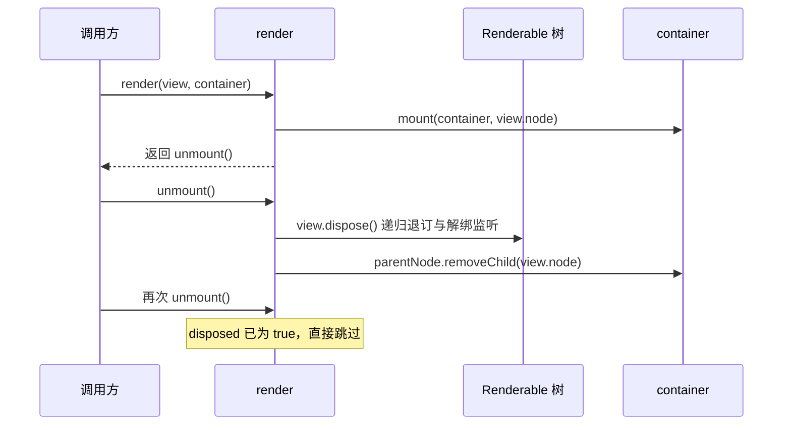

import LessonSolution from "../../components/LessonSolution.astro";

在 [4.3](../4.3-renderable-tree/) 里，我们已经能用 `createRenderableElement` 组合出整棵带有递归清理能力的视图树，但最后一步还停留在手工调用 `mount(app, card.node)`。调用方如果之后想把这个视图从页面上撤掉，依然得自己记住“先调 `card.dispose()`，再把 `card.node` 从父节点移除”两件事。

这一节我们补上最小 DOM 渲染器的最后一块拼图：`render(renderable, container)`。

## `render` 要守住的三条边界

`render` 接收一个根 `Renderable<Node>` 和目标容器 `container`，把根节点挂进容器，并返回一个卸载函数 `Dispose`。看起来只有寥寥几行，但有三条边界不能马虎：

1. **同时清理订阅和移除 DOM**：只移除 DOM 节点、忘了调 `renderable.dispose()`，已被移走的响应式文本依然会挂在 signal 上白跑；只调 `dispose()`、不移除节点，页面上还会留着僵死的旧 DOM。两者必须成对完成。
2. **只移除本次挂载的根节点**：不要图省事写 `container.textContent = ""`，那样会把容器里原本存在的兄弟节点一起清掉。也不要直接假定 `container.removeChild(renderable.node)` 一定成功，用 `renderable.node.parentNode?.removeChild(renderable.node)` 既精准移除自己，又能在节点早已被外部移走时安全跳过。
3. **卸载函数本身保持幂等**：用闭包的 `let disposed = false` 兜底，第二次再调用卸载函数直接返回，确保底层的 `renderable.dispose()` 不会被重复触发。



## 浏览器中的完整体验

这一节的 `src/main.ts` 用我们自己写的 `createSignal`、`createEffect`、`createReactiveText`、`createRenderableElement` 和 `render`，把 [4.0](../4.0-dom-renderer/) 的完整演示 1:1 复现到了浏览器页面里：右上角的 `已挂载 / 已卸载` 徽章、单按钮卸载/重新挂载切换、`外部写入 setCount(...)` 以及底部的“响应式文本更新次数”观察行全部由 `nano-solid` 驱动。

> [!PRACTICE]
>
> ```sh
> git switch -c solve/4.4 4.4-learn
> ```
>
> 起手运行 `pnpm dev` 打开浏览器页面，点 `调用 dispose() 卸载` 后旧计数器依然留在页面上，接着点 `外部写入 setCount(...)` 会看到旧计数器和底部的“响应式文本更新次数”仍在继续增长。补齐 `src/dom.ts` 中的 `render` 卸载逻辑，让卸载后旧视图被移除、外部写入时更新次数保持静止（行为与 [4.0](../4.0-dom-renderer/) 完全一致），并确保 `pnpm format && pnpm check && pnpm test:run && pnpm build` 全部通过。

<LessonSolution slug="4.4-render-unmount" tag="4.4-solution" />
