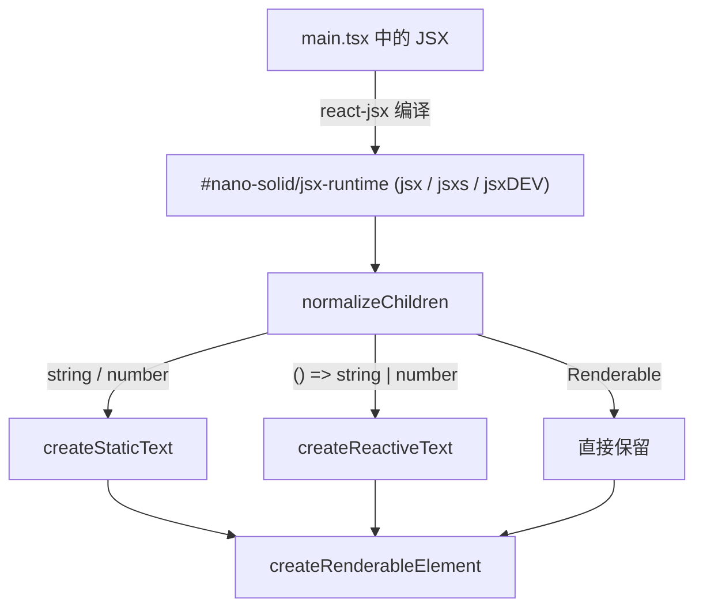

import LessonSolution from "../../components/LessonSolution.astro";

在 [5.0](../5.0-jsx-components/) 里我们对比了命令式造树和 JSX 写法的差距。动手写代码前，先搞清楚 JSX 到底是什么，以及为什么我们不需要引入 React 也能用上它。

## JSX 是什么，由谁来转换？

JSX 是一种类 XML 的 JavaScript/TypeScript 语法扩展，最初由 React 提出，但语法本身**并不绑定 React，也不预设虚拟 DOM**。浏览器并不认识尖括号语法，JSX 只是一套编译期约定：构建工具看到标签表达式时，会把它改写成普通的 JavaScript 函数调用。

在我们这套工程里，有两个工具同时读取 `tsconfig.json` 中的 JSX 配置：

- **Vite 与 Vitest**：在 `pnpm dev`、`pnpm build` 和 `pnpm test:run` 时，由底层的构建转换器把 `.tsx` 文件中的 JSX 真正改写成函数调用。
- **TypeScript（`tsc`）**：按同一份配置做静态类型检查，验证标签名是否合法、属性类型是否匹配、以及整段 JSX 表达式的返回值类型。

## 接入 `react-jsx` 自动转换协议

现代前端工具链普遍支持自动 JSX 转换模式（Automatic Runtime）。在 `tsconfig.json` 里加上这两行配置：

```json
{
  "compilerOptions": {
    "jsx": "react-jsx",
    "jsxImportSource": "#nano-solid"
  }
}
```

配置生效后，编译器会自动在文件顶部补上导入语句，并把标签改写成函数调用：

```tsx
// 你写的代码
<p>Count: {() => count()}</p>;

// 生产模式下编译后的结果（单子节点调用 jsx，多子节点调用 jsxs）
import { jsxs } from "#nano-solid/jsx-runtime";
jsxs("p", { children: ["Count: ", () => count()] });

// Vite 开发模式下会改为调用 jsxDEV，并附带源码位置等调试参数
import { jsxDEV } from "#nano-solid/jsx-dev-runtime";
jsxDEV("p", { children: ["Count: ", () => count()] }, undefined, true);
```

要让自己的运行时顺利对接这套转换协议，需要满足三项要求：

1. **模块路径解析**：编译器会根据 `jsxImportSource` 自动寻找 `<source>/jsx-runtime`（生产）和 `<source>/jsx-dev-runtime`（开发）。我们在 `package.json` 里用 Node.js 标准的包内子路径映射（`"imports"`），把两条路径都指向同一份 `src/jsx-runtime.ts`：

   ```json
   "imports": {
     "#nano-solid/jsx-runtime": "./src/jsx-runtime.ts",
     "#nano-solid/jsx-dev-runtime": "./src/jsx-runtime.ts"
   }
   ```

   为什么名字前面要带一个 `#`，写成 `"#nano-solid"` 而不是直接写最终包名 `"nano-solid"`？因为 Node.js 规范强制要求 `"imports"` 里的仓内别名必须以 `#` 开头，以便在语法上和第三方 npm 包区分开；如果想按真实包名 `"nano-solid"` 自引用，则必须提前把对外发布字段 `"exports"` 临时指向裸 `.ts` 源码。现在用 `"imports"` 承接开发期免构建直连，`tsc`、Vite 和 Vitest 都能沿着标准映射找到运行时；等最后一章完成构建并配置 `"exports"` 指向编译产物后，外部项目就可以直接去掉 `#` 写成 `"nano-solid"`。

2. **运行时导出函数**：运行时模块必须导出 `jsx(type, props, key?)`、`jsxs(type, props, key?)` 和 `jsxDEV(type, props, key?, isStaticChildren?, source?, self?)`。0 个或 1 个静态子节点走 `jsx`，2 个及以上静态子节点走 `jsxs`，开发模式走 `jsxDEV`。我们目前用不到 `key` 和源码定位参数，实现好 `jsx(tag, props)` 后直接导出 `export const jsxs = jsx` 与 `export const jsxDEV = jsx` 就能完整兼容协议。
3. **TypeScript 类型命名空间（`export namespace JSX`）**：`tsc` 会读取运行时模块导出的 `JSX` 命名空间来做类型检查：
   - `JSX.Element`：决定每段 JSX 表达式的返回类型。我们把它设为 `Renderable`，这样 `render(<p>...</p>, container)` 就能直接对齐类型。
   - `JSX.IntrinsicElements`：映射所有允许书写的小写原生标签名及其允许的 `props` 类型。我们基于 `HTMLElementTagNameMap` 覆盖全部标准 HTML 标签，标签体内的子节点由 TypeScript 默认对应到 `props.children`。



注意它和 React 最大的区别：**`jsx()` 不会构造虚拟 DOM 对象，而是直接调用第四章写好的 `createRenderableElement` 返回真实 DOM 的 `Renderable`**。

> [!NOTE]
> 想进一步翻阅这套协议的官方规范，可以参考以下文档：
>
> - [TypeScript 手册：JSX](https://www.typescriptlang.org/docs/handbook/jsx.html)（`JSX` 命名空间与类型检查规则）
> - [TSConfig 说明：`jsx`](https://www.typescriptlang.org/tsconfig/#jsx) 与 [`jsxImportSource`](https://www.typescriptlang.org/tsconfig/#jsxImportSource)
> - [Introducing the New JSX Transform](https://legacy.reactjs.org/blog/2020/09/22/introducing-the-new-jsx-transform.html)（`react-jsx` 与 `jsx` / `jsxs` / `jsxDEV` 自动转换协议出处）
> - [Node.js 文档：Subpath imports](https://nodejs.org/api/packages.html#subpath-imports)（`package.json` 中 `"imports"` 的 `#` 内部映射标准）

## 子节点归一化要处理的六种情况

`props.children` 可能是单个值，也可能是嵌套数组，甚至混着空值和函数。`normalizeChildren(children)` 需要把它们全部折平成 `Renderable[]`：

- **`null`、`undefined`、`boolean`**：直接返回 `[]`。忽略 `true` 和 `false` 能让后面的条件表达式（如 `show && <p>...</p>`）自然成立，不会把 `"false"` 印到页面上。
- **`string`**：交给 `createStaticText(children)`。
- **`number`**：转为字符串后交给 `createStaticText(String(children))`。这里要特别小心：绝对不能用 `if (!children) return []` 判断空值，否则数字 `0` 会被误伤丢掉。
- **`Array`**：用 `children.flatMap(normalizeChildren)` 递归展平任意层级的嵌套数组。
- **`function`**：视为响应式文本 getter，交给 `createReactiveText(() => String(children()))`，挂进树后也会随着父元素自动释放。
- **已有 `Renderable`**：用 `isRenderable(children)` 识别后直接包成单元素数组 `[children]`；如果落到其他不支持的类型（例如普通对象），显式抛出 `Error("Unsupported JSX child: ...")`。

> [!PRACTICE]
>
> ```sh
> git switch -c solve/5.1 5.1-learn
> ```
>
> 入口已切换到 `src/main.tsx`，并用 JSX 改写了底部的观察行。起手运行 `pnpm dev` 打开页面可以看到计数器正常显示，但最底部的“信号当前值 / 响应式文本更新次数”一行是空的（因为 `normalizeChildren` 还没处理数组和函数子节点）。补齐 `src/jsx-runtime.ts` 中的 `normalizeChildren`，让底部观察行恢复实时显示，并确保 `pnpm format && pnpm check && pnpm test:run && pnpm build` 全部通过。

<LessonSolution slug="5.1-jsx-runtime" tag="5.1-solution" />
