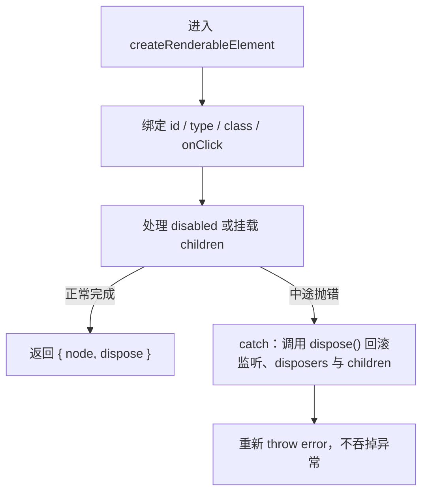

import LessonSolution from "../../components/LessonSolution.astro";

在 [5.2](../5.2-props-and-events/) 结束时，计数器大部分界面已经写成 JSX，但右上角的状态徽章和底部卸载按钮的 `class` 仍然挂着两段外层手写的 `createEffect`，计数为 `0` 时也没法自动禁用 `重置` 按钮。

这一节我们希望直接把动态属性以函数 getter 的形式写在 JSX 上，并守住“元素构造到一半抛错时不漏订阅”的异常安全边界：

```tsx
<span
  class={() =>
    count() < 0 ? "ns-counter-value ns-counter-value-negative" : "ns-counter-value"
  }
>
  {() => count()}
</span>

<button
  type="button"
  class="ns-btn"
  disabled={() => count() === 0}
  onClick={() => setCount(0)}
>
  重置
</button>
```

## 用 `bindProperty` 统一静态与响应式属性

无论是 `class` 还是 `disabled`，套路完全一致：传入普通值时写入一次就结束，传入函数 getter 时交给 `createEffect` 追踪读取并把释放函数收进 `disposers`。把这段逻辑抽成一个泛型辅助函数 `bindProperty<T>(value, apply)`：

```ts
function bindProperty<T>(value: T | (() => T), apply: (next: T) => void): Dispose {
  if (typeof value === "function") {
    const getter = value as () => T;
    return createEffect(() => apply(getter()));
  }
  apply(value);
  return () => {};
}
```

对按钮的 `disabled` 有两个容易踩坑的细节：

1. **只允许 `<button>` 使用**：先检查 `element instanceof HTMLButtonElement`，如果不是按钮标签直接抛出错误 `The "disabled" prop is not supported on <${tag}>`，避免悄悄往 `<div>` 上写无效属性。
2. **直接写 DOM 属性 `element.disabled = value`**：不要用 `setAttribute("disabled", String(value))`。在 HTML 规范里，只要 `disabled` 特性存在（哪怕写成 `disabled="false"`），按钮依然会被禁用。直接操作布尔属性 `element.disabled`，从 `true` 切回 `false` 时按钮才会立刻恢复可点击。

## 构造中途抛错时如何避免半截泄漏？

想一下下面这段代码在构造 `<button>` 时发生了什么：

```tsx
<button
  class={readClass}
  onClick={handleClick}
  disabled={() => {
    throw new Error("boom");
  }}
>
  {readLabel}
</button>
```

1. 进入 `createRenderableElement` 之前，子节点 `{readLabel}` 已经被 `normalizeChildren` 建成了响应式 `Text` 节点并注册了订阅。
2. 绑定 `class` 时，`bindProperty` 为 `readClass` 创建了 `createEffect` 并推入 `disposers`。
3. 绑定 `onClick` 时，向按钮注册了点击监听。
4. 走到 `disabled` 时，`bindProperty` 首次执行 getter 直接抛出 `Error("boom")`，函数立刻中断，调用方拿不到返回的 `Renderable` 和 `dispose`。

如果没有 `try / catch` 兜底，前面 1、2、3 步建立的订阅和监听就会永久泄漏。同理，在非按钮标签上误传 `disabled` 触发校验报错时，也会在同一个位置中途中断。

给构造主体套上一层 `try / catch`，在 `catch (error)` 里先调用当前元素的 `dispose()` 回滚所有已登记的监听、属性 effect 和 `children`，再原样 `throw error`，同时给 `dispose()` 加上 `disposed` 幂等守卫：



> [!NOTE]
> 这里的 `try / catch` 能完整回滚**当前元素已经接手**的监听、属性订阅和 `children`。但如果一个父元素有两个兄弟 JSX 子节点 `<A /><B />`，`<A />` 刚建好后 `<B />` 自己抛错了，代码还没走到父元素的 `createRenderableElement`，`<A />` 的清理就需要更高层的所有权树（`createRoot`）来接管。这部分会在第六章展开。

> [!PRACTICE]
>
> ```sh
> git switch -c solve/5.3 5.3-learn
> ```
>
> `src/main.tsx` 已经移除所有手写外层 `createEffect`，改为直接通过响应式 `class` 和 `disabled` 驱动状态徽章、负数警示色、卸载按钮样式以及 `重置` 按钮禁用状态。起手运行 `pnpm dev` 打开页面可以看到动态样式没有生效、`重置` 按钮在 `0` 时仍可点击。补齐 `src/dom.ts` 中的 `bindProperty`、`disabled` 校验绑定以及 `try / catch` 构造回滚，让页面交互与 [5.0](../5.0-jsx-components/) 保持一致，并确保 `pnpm format && pnpm check && pnpm test:run && pnpm build` 全部通过。

<LessonSolution slug="5.3-reactive-props" tag="5.3-solution" />
