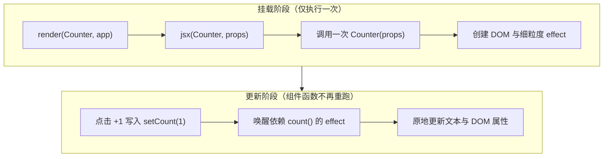

import LessonSolution from "../../components/LessonSolution.astro";

到 [5.3](../5.3-reactive-props/) 为止，我们已经可以用 JSX 写出带响应式文本、动态 `class`、动态 `disabled` 和点击事件的原生标签，但组装计数器视图仍然要手写普通函数调用 `createCounterView(count, setCount, ...)`。

这一节我们要让自定义函数组件直接像 HTML 标签一样放进 JSX，最后只靠一句 `render(<App />, app)` 启动整个页面：

```tsx
// 你写的代码
<Counter
  count={count}
  onIncrement={() => setCount(count() + 1)}
  onDecrement={() => setCount(count() - 1)}
  onReset={() => setCount(0)}
/>;

// 经过 react-jsx 转换后
jsx(Counter, {
  count,
  onIncrement: () => setCount(count() + 1),
  onDecrement: () => setCount(count() - 1),
  onReset: () => setCount(0),
});
```

## 小写标签与大写组件在编译后的唯一差别

JSX 编译器对标签名的首字母有一条固定规则：

- **小写开头的标签**（如 `<button>`、`<span>`）会被编成**字符串**，传给 `jsx("button", props)`，代表原生 HTML 元素；
- **大写开头的标识符**（如 `<Counter>`、`<App>`）会被编成**变量引用本身**，传给 `jsx(Counter, props)`，代表函数组件。

所以 `src/jsx-runtime.ts` 接入函数组件并不复杂。先定义函数组件的类型 `Component<P>`，再给 `jsx` 补上函数组件重载：

```ts
export type Component<P = Record<string, never>> = (props: P) => Renderable;

export function jsx<K extends Tag>(tag: K, props: Props): Renderable<HTMLElementTagNameMap[K]>;
export function jsx<P>(tag: Component<P>, props: P): Renderable;
export function jsx<P>(tag: Tag | Component<P>, props: Props | P): Renderable {
  if (typeof tag === "function") {
    return tag(props as P);
  }
  const elementProps = props as Props;
  return createRenderableElement(tag, elementProps, normalizeChildren(elementProps.children));
}
```

当 `tag` 是函数时，直接调用 `tag(props as P)` 返回它拼装出来的 `Renderable` 即可。如果组件内部又嵌套了 `<Card><p>...</p></Card>`，外层标签体里的子节点会以 `props.children` 传进 `Card`，`Card` 把 `{props.children}` 放到自己的 JSX 里时，再交由 `normalizeChildren` 统一展开和接管清理。

## 核心心智模型：组件函数只执行一次

仔细看上面那行 `return tag(props as P)`。我们**没有**给组件函数套上 `createEffect`，也没有保存任何“重渲染队列”。

这就是 `nano-solid`（以及 SolidJS）与 React 最根本的区别：



1. **挂载时**：`Counter(props)` 只跑这一次，把信号、真实 DOM 节点、事件监听和细粒度 `createEffect` 全部搭建好，返回一棵带有递归 `dispose()` 的 `Renderable` 树。
2. **更新时**：无论用户点多少次 `+1`、`-1`、`重置`，`setCount` 只会精准唤醒读取了 `count()` 的那几个文本和属性 effect，`Counter` 函数本身**永远不会重新执行**。只有整棵子树被 `dispose()` 卸载、以后再次创建挂载时，组件函数才会重新跑一遍。

> [!NOTE]
> 因为组件函数只在创建时执行一次，**不要在组件顶部提前把响应式值解包成普通变量**。例如写 `const current = props.count()` 再去渲染 `{current}`，页面只会永远停在初始值；必须把 `props.count()` 留进 `{() => props.count()}` 或 `class={() => ...}` 这类函数 getter 里，让对应的 `createEffect` 追踪到读取。

这一节同时移除了第四章引入的过渡文件 `src/counter.ts` 和 `src/counter.test.ts`，原有的加减、重置和卸载后不再响应等断言已经整体迁入 `src/jsx-runtime.test.tsx` 的 `<Counter />` 测试里。

> [!PRACTICE]
>
> ```sh
> git switch -c solve/5.4 5.4-learn
> ```
>
> `src/main.tsx` 已经重构为 `<Counter />`、`<EmptyState />` 和 `<App />` 三个函数组件，并在页面底部展示“组件函数执行次数”与“文本节点更新次数”的实时对比。起手运行 `pnpm dev` 打开页面会看到空白并抛出 `Function component "App" is not implemented yet` 错误。补齐 `src/jsx-runtime.ts` 中 `jsx` 的函数组件分支，打开页面验证点击加减重置时“组件函数执行次数”停在 `1` 而“文本节点更新次数”持续增长（卸载并重新挂载后组件执行次数才变为 `2`），与 [5.0](../5.0-jsx-components/) 演示完全一致，并确保 `pnpm format && pnpm check && pnpm test:run && pnpm build` 全部通过。

<LessonSolution slug="5.4-components" tag="5.4-solution" />
