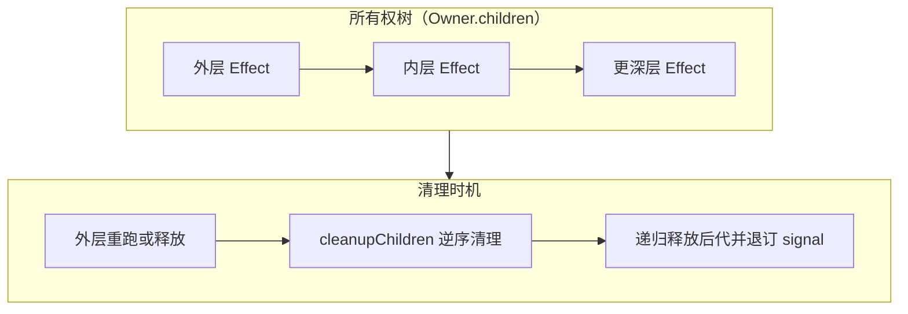

import LessonSolution from "../../components/LessonSolution.astro";

在第三章我们实现了 `createEffect` 的动态依赖重建和 `dispose` 释放句柄，但当时还有一个隐藏的泄漏场景没有解决：当一个 `createEffect` 内部又创建了另一个 `createEffect` 时，内层 effect 归谁管？

先看下面这段代码：

```ts
const [outer, setOuter] = createSignal(0);
const [inner, setInner] = createSignal(0);

createEffect(() => {
  const step = outer();
  createEffect(() => {
    console.log(`${step}:${inner()}`);
  });
});

setOuter(1);
setOuter(2);
setInner(1);
```

直观上，经过两次 `setOuter` 之后，当前活跃的只有 `step = 2` 这一轮创建的内层 effect，最后 `setInner(1)` 应该只打印一次 `"2:1"`。但在当前实现里，它会连着打印三次：`"0:1"`、`"1:1"`、`"2:1"`。外层每重跑一次，就会在 `inner` 上多挂一个永远不会销毁的僵尸订阅；就算调用外层的 `dispose()`，所有内层 effect 依然会继续跑。

## 把 `currentOwner` 和 `currentEffect` 分开

解决这个问题只需要在 `src/reactive.ts` 引入**所有权节点**（`Owner`）的概念：

```ts
type Owner = {
  parent: Owner | undefined;
  children: Set<Owner>;
  disposed: boolean;
  onDispose?: () => void;
};

type Effect = Owner & {
  callback: EffectCallback;
  dependencies: Set<Set<Effect>>;
};
```

同时维护两个独立的全局栈顶指针：

- **`currentEffect`**：记录“谁正在追踪 signal 读值”。
- **`currentOwner`**：记录“新创建的资源归哪个作用域管”。

这一节里 `Effect` 同时扮演两个角色，看起来两者总是一起切换；但下一节引入 `createRoot` 时你马上会看到拆开的价值：`createRoot` 是一个只管生命周期、不追踪依赖的 `Owner`，执行时它会设置 `currentOwner` 而把 `currentEffect` 置空。



## 三处关键联动

让整棵所有权树转起来，需要串起三个动作：

1. **创建时挂入父节点**：`createEffect` 创建 `effect` 时，如果 `currentOwner` 存在且尚未释放，就把 `effect` 加进 `currentOwner.children`，同时在 `effect.parent` 记下它。当某个内层 effect 被提前手动释放时，`disposeOwner` 会顺手把它从 `parent.children` 摘除，不留死引用。
2. **重跑前先清理上一轮子作用域**：`runEffect(effect)` 在执行 `effect.callback()` 前，除了调用 `cleanupDependencies(effect)` 清空旧订阅，还要先调用 `cleanupChildren(effect)` 把上一轮创建的全部内层 effect 释放干净。
3. **成对切换与恢复 `currentOwner`**：在 `runEffect` 里像保存 `currentEffect` 一样保存 `previousOwner = currentOwner`，进入回调前设为 `effect`，在 `finally` 里原样恢复。如果外层在创建完内层 effect 后中途抛错，`catch` 里的 `disposeOwner(effect)` 也会顺着 `children` 把刚建好的内层 effect 一并回收。

> [!NOTE]
> `cleanupChildren` 在遍历前要像通知订阅者那样先复制一份 `Array.from(owner.children)` 并清空原集合，再按逆序（LIFO）逐个调用 `disposeOwner(child)`。这样一方面避免遍历中途修改集合，另一方面与下一节 `onCleanup` 的后进先出释放顺序保持一致。

> [!PRACTICE]
>
> ```sh
> git switch -c solve/6.1 6.1-learn
> ```
>
> `src/reactive.ts` 已经定义好 `Owner`、`currentOwner` 与 `disposeOwner` 骨架，`src/reactive.test.ts` 新增了 4 条嵌套 effect 所有权测试（包括重跑清理、多层递归释放、内层抛错恢复外层归属，以及外层中途抛错回收已建内层）。补齐 `src/reactive.ts` 中的三处 `// TODO`，确保 `pnpm format && pnpm check && pnpm test:run` 全部通过。

<LessonSolution slug="6.1-nested-effects" tag="6.1-solution" />
