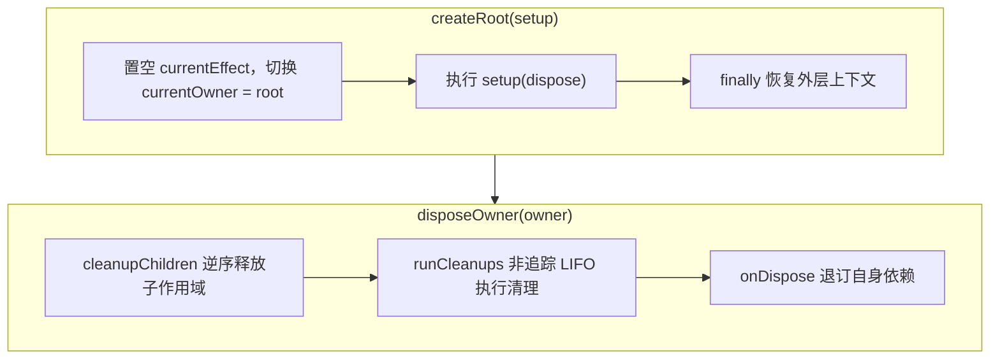

import LessonSolution from "../../components/LessonSolution.astro";

在 [6.1](../6.1-nested-effects/) 里，外层 `createEffect` 已经能自动清理它内部创建的嵌套 effect。但还有两类现实场景它覆盖不到：

1. **应用根节点或组件本身不是一个 effect**：就像第五章讲过的，组件函数只在挂载时跑一次，并不是由 `createEffect` 驱动的。我们需要一个**只管理生命周期、不追踪依赖**的顶层作用域，把一整棵组件树里的所有副作用收归门下。
2. **清理对象不只是 effect**：组件里启动的 `setInterval`、注册在 DOM 上的 `addEventListener`、打开的订阅连接，都需要在所属作用域重跑或销毁时配对释放。

这一节引入两个核心原语 `createRoot` 和 `onCleanup`，让下面这样的代码自然成立：

```ts
const dispose = createRoot((disposeRoot) => {
  const timer = setInterval(() => tick(), 1000);
  onCleanup(() => clearInterval(timer));

  createEffect(() => {
    console.log(count());
  });

  return disposeRoot;
});

// 一句 dispose() 同时停止内部所有 effect 并执行登记的 clearInterval。
dispose();
```

## `createRoot` 的三条约定

`createRoot<T>(setup: (dispose: Dispose) => T): T` 会创建一个普通的 `Owner` 节点作为独立根作用域，执行 `setup(dispose)` 并返回其结果。实现时要守住三条关键约定：

1. **独立根（`parent: undefined`）**：`createRoot` 创建的作用域**不会**自动挂进外层 `currentOwner`。这样后面实现 `<Show>` 时，我们在条件监控 effect 内用 `createRoot` 创建分支作用域，条件重跑但真假不变时，不会把当前分支误杀；需要跟随外层销毁时，由调用方显式写一句 `onCleanup(dispose)` 即可。
2. **屏蔽外层依赖追踪（`currentEffect = undefined`）**：进入 `setup` 前把 `currentEffect` 置空，并在 `finally` 里恢复外层 `currentEffect` 和 `currentOwner`。这样根作用域内部的普通 signal 读值不会意外污染外层正在运行的 effect。
3. **构造失败自动回滚**：如果 `setup` 在登记完若干 `createEffect` 或 `onCleanup` 后中途抛错，`catch (error)` 必须先调用 `dispose()` 清理掉已建立的资源，再原样 `throw error`。

## `onCleanup` 的执行时机与非追踪边界

给 `Owner` 加上 `cleanups: Dispose[]` 后，`onCleanup(cleanup)` 的工作非常直接：只要当前存在未释放的 `currentOwner`，就把 `cleanup` 推入 `currentOwner.cleanups`；如果当前不在任何作用域内（例如测试里单独构造一个节点），静默忽略而不报错。

清理回调会在两个时机触发：**`createEffect` 每次重跑之前**，以及 **`disposeOwner` 释放作用域之时**。这两种情况都调用 `runCleanups(owner, errors)`。

- **后进先出（LIFO）**：用 `owner.cleanups.splice(0).reverse()` 取出并清空列表，后申请的资源先释放，与嵌套作用域的栈结构保持一致。
- **在非追踪上下文中执行**：执行清理回调期间同样把 `currentEffect` 和 `currentOwner` 暂存并置空，执行完在 `finally` 里恢复。否则当一个外层 effect 触发重跑或释放旧分支时，如果旧分支的 `onCleanup` 里顺手读了某个 signal，就会被误登记成外层 effect 的新依赖。



> [!NOTE]
> 清理回调也会抛错。每次捕获一条异常，就把它记进这次释放共用的 `errors`，再继续清理兄弟作用域和剩余回调。主动释放时在最后报告异常。如果是 `setup` 失败引发回滚，清理结束后仍抛出 `setup` 的原始异常。

> [!PRACTICE]
>
> ```sh
> git switch -c solve/6.2 6.2-learn
> ```
>
> `src/reactive.ts` 已经为 `Owner` 增加了 `cleanups` 字段并声明了 `runCleanups`、`onCleanup` 与 `createRoot` 签名，`src/reactive.test.ts` 新增了 8 条覆盖根作用域回收、LIFO 清理顺序、effect 重跑前清理、追踪隔离、异常回滚、清理期非追踪以及清理抛错后继续释放的测试。补齐 `src/reactive.ts` 中的三处 `// TODO`，确保 `pnpm format && pnpm check && pnpm test:run` 全部通过。

<LessonSolution slug="6.2-root-and-cleanup" tag="6.2-solution" />
