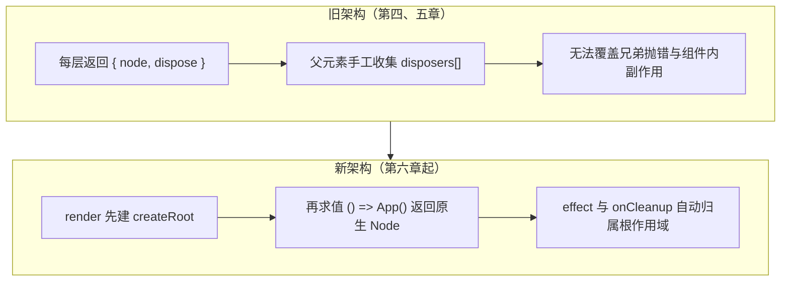

import LessonSolution from "../../components/LessonSolution.astro";

有了 [6.2](../6.2-root-and-cleanup/) 的 `createRoot` 和 `onCleanup`，我们在第四章为了搬运清理函数而发明的 `Renderable<{ node, dispose }>` 就正式完成了它的历史使命。

这一节我们把职责彻底拆干净：**原生 `Node` 只负责挂到 DOM 哪里，所有权树负责什么时候清理**。

## 为什么 `render` 要从 `render(<App />, app)` 改成 `render(() => <App />, app)`？

先看两行调用的求值顺序差异：

```tsx
// 旧写法：在进入 render 之前，<App /> 就已经被求值执行完了
render(<App />, app);

// 新写法：render 先建立 createRoot，再在根作用域内调用 () => <App />
render(() => <App />, app);
```

在 JavaScript 里，函数实参总是在进入函数体之前先求值。如果写成 `render(<App />, app)`，`<App />` 里的 `createEffect` 和 `onCleanup` 执行时，`render` 内部的 `createRoot` 根本还没开始，整棵树的副作用都找不到归属。

把第一个参数改成延迟工厂 `view: () => Node` 后，一切顺理成章：

1. **退掉 `Renderable`**：`src/dom.ts` 收敛为四个核心入口：`createText(value)`、`createReactiveText(getValue)`、`createElement(tag, props, children)` 和 `render(view, container)`。`JSX.Element` 直接就是原生 `Node`。
2. **去掉元素层手工清理代码**：`createElement` 不再需要维护 `disposers[]`、不再手写递归 `children.dispose()`，也不再套一层元素级 `try / catch`。`bindProperty` 里的 `createEffect` 自动归入当前 Owner，`onClick` 的解绑直接写进 `onCleanup(() => element.removeEventListener("click", handleClick))`。
3. **自动兜住兄弟节点抛错回滚**：遇到 `<div><FirstSibling /><BrokenSibling /></div>` 时，即使 `BrokenSibling` 抛错时父元素 `<div>` 还没开始构造，`FirstSibling` 已经把自己的订阅和点击监听登记进了 `render` 的 `createRoot`，`createRoot` 的 `catch` 会立刻把 `FirstSibling` 清理干净，彻底填平 [5.3](../5.3-reactive-props/) 留下的缺口。



## 为下一节 `<Show>` 铺路：`DocumentFragment` 与 `try / finally` 安全卸载

下一节实现 `<Show>` 时，一个条件组件可能需要一次性往容器里挂载多个节点（例如两枚注释锚点加中间的真实内容），最自然的返回类型就是原生 `DocumentFragment`（它本身继承自 `Node`）。

但 `DocumentFragment` 有一个著名的 DOM 特性：**调用 `container.appendChild(fragment)` 后，fragment 内部的全部子节点会被搬进 `container`，而 fragment 自己瞬间变成空的**。如果卸载时直接对空的 `fragment` 调 `removeChild`，页面上挂载出来的节点一个都移不走。

因此 `render` 的挂载与卸载还要守住三条边界：

1. **挂载前快照子节点**：如果 `node instanceof DocumentFragment`，在 `container.appendChild(node)` 之前先把 `Array.from(node.childNodes)` 存成 `mountedNodes`；普通节点直接存 `[node]`。
2. **用 `try / finally` 兜住 DOM 移除**：卸载时把 `dispose()` 放进 `try`，把移除 `mountedNodes` 的循环放进 `finally`。即使某个用户注册的 `onCleanup` 抛错，已挂载的节点依然会从容器移除，不会卡死在页面上。
3. **只移除仍属于目标容器的节点**：移除前判断 `mounted.parentNode === container` 再调 `container.removeChild(mounted)`。这样既不会误伤容器原有的兄弟节点，也不会把已经被外部代码移到别处的节点强行拆走。

> [!NOTE]
> 在 `src/main.tsx` 里，`App` 暂时还保留着手动切换 `<Counter />` 和 `<EmptyState />` 的 `host`，但现在可以直接在 JSX 里写 `{host}` 并通过 `onCleanup(() => unmountActiveView?.())` 接管清理，不再需要 `{ node: host, dispose }` 包装。下一节引入 `<Show>` 后，连 `host` 和 `unmountActiveView` 也会一起消失。

> [!PRACTICE]
>
> ```sh
> git switch -c solve/6.3 6.3-learn
> ```
>
> `src/dom.ts`、`src/jsx-runtime.ts`、`src/main.tsx` 及全部既有测试已迁移到原生 `Node` 与 `render(() => ..., container)`，`src/jsx-runtime.test.tsx` 中也已加入“兄弟节点抛错回滚”和“函数组件内 `onCleanup` 自动清理”测试。`src/dom.test.ts` 新增了 3 条 `it.skip` 测试，覆盖 `DocumentFragment` 快照卸载、清理抛错时的 `finally` 节点移除，以及节点已被迁走时不误删。补齐 `src/dom.ts` 中 `render` 的两处 `// TODO`，确保 `pnpm format && pnpm check && pnpm test:run && pnpm build` 全部通过。

<LessonSolution slug="6.3-native-nodes-render" tag="6.3-solution" />
