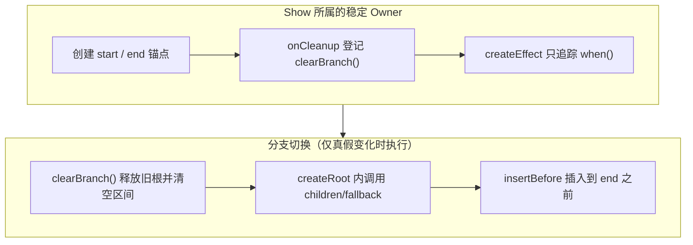

import LessonSolution from "../../components/LessonSolution.astro";

到 [6.3](../6.3-native-nodes-render/) 为止，`src/main.tsx` 已经不再需要 `Renderable`，但 `App` 里还留着最后一块命令式胶水：为了切换 `<Counter />` 和 `<EmptyState />`，我们仍要手建 `host` 容器、保存 `unmountActiveView` 并在按钮点击时手动调用 `render`。

这一节我们新增 `src/control-flow.ts` 实现 `<Show>`，把它彻底变成声明式代码：

```tsx
<Show when={visible} fallback={() => <EmptyState />}>
  {() => <LiveCounter onTick={recordTick} onDispose={recordCleanup} />}
</Show>
```

## 为什么分支要传懒工厂函数 `() => <LiveCounter />`？

熟悉原版 SolidJS 的同学可能会发现一个细节：原版 SolidJS 里可以写成下面这样：

```tsx
// 原版 SolidJS：由 Babel 编译插件在编译期把属性和子节点包成惰性 getter
<Show when={visible()} fallback={<EmptyState />}>
  <LiveCounter />
</Show>
```

而我们的 `nano-solid` 用的是标准的 `react-jsx` 转换，**没有自定义编译期改写**。在普通 JavaScript 求值顺序下，如果直接写 `<Show when={visible} fallback={<EmptyState />}><LiveCounter /></Show>`，`<EmptyState />` 和 `<LiveCounter />` 会在进入 `Show` 之前就立刻被求值执行，不仅隐藏分支会被白白构造出来，它们的副作用还会错挂到外层 Owner 上，切走再切回也无法创建新实例。

因此我们把 `when` 定为 getter，把 `children` 和 `fallback` 定为懒工厂函数 `() => Node`，让 `<Show>` 自己决定**何时**以及**在哪个作用域内**调用它们。

## 双 `Comment` 锚点与分支所有权设计

实现 `<Show>` 只需要把握住两组配合：

1. **一对 `Comment` 锚点 + `DocumentFragment` 首次插入**：
   - `Show` 创建 `start = document.createComment("show-start")` 和 `end = document.createComment("show-end")`，先挂进一个 `DocumentFragment`。
   - 无论是在首次挂载前（`end.parentNode` 指向 `fragment`），还是插入真实页面后（`end.parentNode` 指向父元素或 `container`），`end.parentNode` 始终是当前区间的父节点。插入新分支直接调 `parent.insertBefore(branchNode, end)`，清空旧分支只需从 `start.nextSibling` 删到 `end` 之前（既支持单节点，也天然支持嵌套 `<Show>`）。
   - 当 `<Show>` 直接作为 `render(() => <Show ... />, container)` 的根节点卸载时，`<Show>` 的 `onCleanup` 负责释放当前分支并清空两枚锚点之间的动态内容，`render` 的 `finally` 负责移除挂载前快照里的两枚锚点，容器不留一丝残余。
2. **分支独立 `createRoot` + `<Show>` 稳定 `onCleanup`**：
   - 在 `createEffect` 里只读取 `Boolean(props.when())`。如果 `hasRendered` 已为真且真假结果没变（例如 `count` 从 `1` 变成 `2`），直接 `return` 保留现有分支和 DOM 实例。
   - 切换分支时先调用 `clearBranch()`（释放旧分支并清空区间），再把 `factory()` 放进独立的 `createRoot` 中执行：因为 `createRoot` 会置空 `currentEffect` 且不挂入监控 `when` 的 effect，所以分支内部的读值不会污染 `when`，`when` 重跑时也不会误杀仍需保留的分支。
   - 同时在 `<Show>` 自身所属的稳定 Owner 上登记一次 `onCleanup(() => clearBranch())`，外层卸载时就能级联释放当前活跃分支。



> [!PRACTICE]
>
> ```sh
> git switch -c solve/6.4 6.4-learn
> ```
>
> `src/main.tsx` 已经彻底删掉 `host` 与 `unmountActiveView`，改为用 `<Show>` 切换带定时器和 `onCleanup` 的 `<LiveCounter />` 与 `<EmptyState />`。起手运行 `pnpm dev` 打开页面可以看到卡片壳子和底部统计正常显示，但中间计数器区域是空的（因为 `Show` 还没实现分支渲染）。补齐 `src/control-flow.ts` 中 `createEffect` 里的 `// TODO`，打开页面验证定时器每秒递增、点击隐藏后 tick 立刻停住且 `onCleanup` 清理次数加一（与 [6.0](../6.0-ownership-and-show/) 演示完全一致），并确保 `pnpm format && pnpm check && pnpm test:run && pnpm build` 全部通过。

<LessonSolution slug="6.4-show" tag="6.4-solution" />
