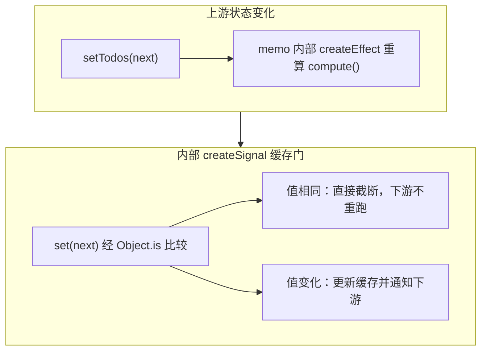

import LessonSolution from "../../components/LessonSolution.astro";

在 [7.0](../7.0-memo-and-for/) 的 Todo 应用里，有两份最典型的派生状态：按当前筛选条件过滤出的 `visibleTodos`，以及统计未完成任务数的 `remainingCount`。

如果直接把它们写成普通箭头函数：

```ts
const remainingCount = () => todos().filter((todo) => !todo.completed).length;
```

看似能跑，但在真实应用里立刻会暴露两个问题：

1. **昂贵计算被多处读取，重复执行会带来明显的性能问题**：如果派生逻辑涉及对几千条任务做过滤、模糊搜索、复杂排序或分组汇总，写成普通函数后，列表区、顶部状态徽章和底部统计栏各自读一次，就会把整套重计算原样跑多遍；缓存之后，同一轮更新只算一次，后续读取全部直接命中缓存。
2. **结果没变也会唤醒下游**：用户编辑一条未完成任务的标题时，`todos` 换成了新数组，但未完成数量依然是 `2`。如果状态徽章直接追踪 `todos`，哪怕数字根本没变，它的 effect 也会跟着白跑一遍。

`createMemo` 就是为了同时解决这两个问题而生的：

```ts
const remainingCount = createMemo(() => todos().filter((todo) => !todo.completed).length);
const completedCount = createMemo(() => todos().length - remainingCount());
```

## 用已有原语拼出 `createMemo`

仔细想一下，`createMemo` 需要具备四项能力：自动追踪上游 signal、缓存最新结果、结果相同时不通知下游、以及能被当前 `Owner` 统一回收。这四件事我们在前六章已经全部造好了：**一个内部 `createSignal` 加上一个内部 `createEffect` 就够了**。

```ts
export function createMemo<T>(compute: () => T): () => T {
  let initialized = false;
  let get!: () => T;
  let set!: (next: T) => void;

  createEffect(() => {
    const next = compute();
    if (!initialized) {
      initialized = true;
      [get, set] = createSignal(next);
    } else {
      set(next);
    }
  });

  return () => get();
}
```

沿着这段 12 行代码走一遍，你会发现四个边界全部自动闭合：

1. **只算一次且无需假初值**：`createEffect` 在创建时会立刻同步执行第一轮，拿到 `next = compute()` 后直接用它初始化 `createSignal(next)`，不用编造 `undefined as T` 占位，也不会多算一遍。
2. **读值命中缓存并建立订阅**：外层返回的 `() => get()` 永远直接读内部 signal。多次读取不重跑 `compute()`；如果在下游 `createEffect` 或另一个 `createMemo` 里读取它，下游订阅的是这个内部 signal，而不是上游原始数据。
3. **同值截断天然生效**：上游变化触发重算后，调用 `set(next)` 会自动经过第三章写好的 `Object.is(value, next)` 检查。只要派生结果没变，下游 effect 和链式 memo 全部纹丝不动。
4. **所有权与异常安全免费继承**：内部 `createEffect` 会自动挂进当前的 `currentOwner`，所属作用域释放时自动退订；如果 `compute()` 首次求值中途抛错，`runEffect` 的 `catch` 会自动清理半截订阅并原样重抛。



> [!NOTE]
> `createMemo` 本身也会维护一个内部 signal 和一个内部 effect，并不是所有派生都需要包一层。像 `() => count() * 2` 这种轻量、单处读取的计算直接写普通函数反而更省；只有**计算开销较大且被多处共享**，或者**输入常变但输出很少变化、需要截断下游更新**时，才应该使用 `createMemo`。

> [!PRACTICE]
>
> ```sh
> git switch -c solve/7.1 7.1-learn
> ```
>
> `src/reactive.ts` 已经声明了 `createMemo<T>(compute: () => T): () => T`（当前起手版只是直接返回 `compute`，既不缓存也不截断），`src/reactive.test.ts` 新增了 5 条 `it.skip` 测试，覆盖多次读取命中缓存、同值不唤醒下游、链式 memo 组合、`createRoot` 自动释放以及首次求值抛错清理。补齐 `src/reactive.ts` 中的 `createMemo`，确保 `pnpm format && pnpm check && pnpm test:run` 全部通过。

<LessonSolution slug="7.1-memo" tag="7.1-solution" />
