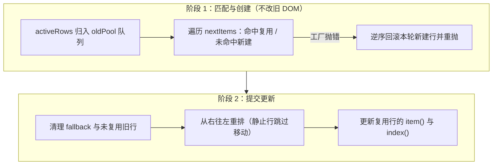

import LessonSolution from "../../components/LessonSolution.astro";

在 [7.1](../7.1-memo/) 有了 `createMemo` 之后，我们可以用 `visibleTodos` 算出当前筛选下应该显示的任务数组。接下来最关键的一步，是把任意动态数组变成真实 DOM 列表，并在增删、勾选和排序时**精准复用已有节点**。

这一节我们要在 `src/control-flow.ts` 里实现 `<For>`，让 Todo 列表能直接写成这样：

```tsx
<For
  each={visibleTodos}
  getKey={(todo) => todo.id}
  fallback={() => <p class="ns-empty">当前筛选下没有待办事项。</p>}
>
  {(todo, index) => (
    <li class="ns-list-item">
      <span>{() => index() + 1}</span>
      <span>{() => todo().text}</span>
    </li>
  )}
</For>
```

## 为什么 `children` 接收的是 `item: () => T` 而不是普通值 `T`？

在 Todo 应用里，我们习惯用不可变方式更新一条任务：

```ts
setTodos(todos().map((todo) => (todo.id === id ? { ...todo, completed: !todo.completed } : todo)));
```

注意这次更新产生了一个**新的对象引用**，但它的 `todo.id` 并没有变。如果 `<For>` 只按对象引用判断身份，勾选完成一次就会把整条 `<li>` 销毁再重建；如果把 `todo` 作为普通值传给行组件，复用旧 `<li>` 后又没法把新对象的 `completed` 和 `text` 同步进去。

把行工厂签名定为 `(item: () => T, index: () => number) => Node`，并支持可选的 `getKey?: (item: T) => K`（省略时默认按元素本身作为 key），就能同时兼顾两种场景：

- **传 `getKey={(todo) => todo.id}`**：不可变更新对象时，按 `id` 命中旧行，调用该行内部的 `setItem(nextTodo)`，同一个 `<li>` 原地更新文字和勾选态，行组件不会重新执行。
- **不传 `getKey`**：默认按元素本身配对复用，连重复原始值数组也能按出现顺序稳定匹配。

> [!NOTE]
> 因为行组件和普通函数组件一样只在创建时执行一次，在行内渲染会随更新变化的字段时，要写成 `{() => todo().text}` 或 `class={() => ...}`，不要在行顶部提前解包成 `const text = todo().text`。

## 为什么每行也要自带一对 `Comment` 锚点？

在 [6.4](../6.4-show/) 里，`<Show>` 用一对注释节点圈出动态区间。`<For>` 不仅外层需要一对 `for-start / for-end` 锚点，**每一行内部也各自包在 `for-item-start / for-item-end` 之间**。

原因很简单：Todo 的每一行内部都嵌着一个 `<Show>`，点击“编辑”时会把原来的 `<span>` 换成 `<input>`。如果每行只记住“首次创建时的节点引用”，以后移动或删除这一行时，运行期被 `<Show>` 换进去的新节点就会被漏在 DOM 里。有了每行专属的 `{ start, end }`，无论行内中途切换了多少次分支，只要从 `entry.start` 走到 `entry.end`，就一定能完整带走这行当前的所有节点。

## 一步步拆解列表协调（Reconciliation）算法

当 `props.each()` 返回一份新数组 `nextItems` 时，我们要把旧的 `activeRows` 平滑过渡到新顺序，这就是**列表协调（Reconciliation）**。整个过程拆成四个环环相扣的设计：

### 1. 用 `Map<key, RowEntry[]>` 队列配对旧行，兼容重复值

把现有 `activeRows` 建索引时，不能写成简单的 `Map<key, RowEntry>`。假设数组是 `["a", "b", "a"]`：如果用单值 Map，第二个 `"a"` 会直接覆盖第一个 `"a"`，导致第一行的 `createRoot` 既没被复用也没被释放。

改成 `Map<unknown, RowEntry<T>[]>` 数组队列后，同一个 key 下的多个旧行按原顺序排成队：遍历 `nextItems` 时调用 `oldPool.get(key)?.shift()` 从队头取旧行复用，没取到就新建一行；遍历结束后，还留在 `oldPool` 各队列里的就是真正被删掉的旧行，统一释放即可。

### 2. 为什么必须分成两阶段（先建齐新行，再提交变更）？

如果在遍历 `nextItems` 的中途一边新建行、一边直接删旧行并更新复用行的 `setItem`，那么一旦第 3 行的工厂函数抛错：

- 前面已经删掉的旧行回不来了；
- 前面复用行的文本已经被改成新值了；
- 画面会停在一个一半旧、一半新的破坏状态。

因此我们严格拆成两阶段：

- **阶段 1（只建新行，不动旧 DOM 与旧行信号）**：遍历 `nextItems`，命中的旧行只先记录进 `reusedUpdates`（暂不调用 `setItem` / `setIndex`），未命中的调用 `createRowEntry` 在独立 `createRoot` 中建好并暂存在各自 `initialFragment` 里。如果任意新行工厂抛错，`catch` 立刻逆序 `disposeRow` 清理本轮新建行再原样重抛，旧画面完好无损。
- **阶段 2（提交清理、重排与信号更新）**：确认全部新行都创建成功后，再清理 `fallback` 和 `oldPool` 里剩余未复用的旧行，接着重排 DOM，最后统一为复用行写入新的 `item` 和 `index`。

### 3. 为什么重排要“从右往左”扫描，而不是“从左往右”？

从数据结构上看，浏览器里的同级 DOM 节点本质是一条双向链表（`previousSibling / nextSibling`），而 `parent.insertBefore(node, referenceNode)` 是一次 `O(1)` 跳移：可以直接把链表任意位置的节点一步摘下来插到 `referenceNode` 左边。因此整个重排不是多趟相邻交换的冒泡排序，而是**一趟完成的倒序双向链表重接（`O(n)`）**。

之所以采用倒序，是因为经典的父节点底层 API 只提供 `parent.insertBefore(node, referenceNode)`（以右邻居作参照，传入 `null` 时等价于追加到末尾；现代 DOM 虽然补了便捷的 `node.after(...)`，但因支持变长参数与字符串转换而有额外开销，框架底层仍普遍使用更薄、更快的 `insertBefore`）。从右往左扫描时，起点天然有一个永远固定不动的右边界：`let cursor: Node = end`（外层 `for-end` 锚点）。

每把当前行 `entry` 放到 `cursor` 前面之后，立刻把游标左移到 `cursor = entry.start`，它就成了左边下一行的精准右邻居。更重要的是，在移动已挂载的旧行之前先判断一句：

```ts
if (entry.end.nextSibling === before) {
  return;
}
```

只要这条链表的 `nextSibling` 指针本来就指着 `before`，说明它已经在正确位置上，**直接跳过 `insertBefore`**。

> [!NOTE]
> **为什么 DOM 底层选择提供 `insertBefore`，而不是 `insertAfter`？**
>
> 只保留单一方向的插入原语是为了接口正交（避免同时维护 `insertBefore` / `insertAfter` / `prepend` / `append` 多套语义重叠的底层操作），而在这两个方向里标准几乎都选择了 `insertBefore`，原因有三点：
>
> 1. **`null` 作为尾哨兵，三种高频操作零分支统一**：把同级节点看作半开区间 `[firstChild, null)`，`null` 天然代表“列表末尾”。于是追加到末尾是 `insertBefore(node, null)`，插到最前面是 `insertBefore(node, parent.firstChild)`，插到节点 `x` 后面是 `insertBefore(node, x.nextSibling)`。哪怕列表为空，或者 `x` 本身就是最后一个节点（`x.nextSibling === null`），这三句代码都不需要任何 `if` 判断。如果反过来用 `insertAfter`，`null` 就得反直觉地代表“插到最前面”，而最常用的末尾追加反而要写成 `insertAfter(node, parent.lastChild)`。
> 2. **与从左往右的常规遍历天然衔接**：查找插入位置时，代码通常从 `firstChild` 顺着 `nextSibling` 往后走，在第一个满足条件的节点 `cur`（或末尾 `null`）处停下。此时直接调用 `insertBefore(node, cur)` 就能落位，无需额外维护一个 `prev` 指针。若用 `insertAfter`，就必须时刻记住前驱节点。
> 3. **与 0 基下标和经典容器设计一致**：在 0 基序列里，“插在下标 `i` 之前”后新元素的下标恰好就是 `i`，`0` 对应头部，`n`（尾哨兵）对应尾部。C++ 的 `std::list::insert(iter, x)`、Python 的 `list.insert(i, x)` 和 Java 的 `List.add(i, x)` 都遵循同一约定。
>
> 换句话说，DOM 选 `insertBefore` 是为了让正向查找与常规插入最顺手，而 `<For>` 做整表重排时顺着这个底层原语反过来“从右往左”推进，正好把 `end` 锚点变成了天然的固定右边界。

### 4. 用 `[A, B, C] -> [A, C, B]` 走一遍完整推演

假设当前 DOM 里的顺序是 `[A, B, C, end]`（其中 `A` 的输入框正处于聚焦状态），现在交换后两项变成 `[A, C, B]`，从右往左执行阶段 2：

1. **处理 `B`（`cursor = end`）**：检查 `B.end.nextSibling`，它是 `C.start !== end`，于是把 `B` 整段（`B.start` 到 `B.end`）插到 `end` 前面。DOM 立刻变成 `[A, C, B, end]`，游标更新为 `cursor = B.start`。
2. **处理 `C`（`cursor = B.start`）**：检查 `C.end.nextSibling`，此时正好等于 `B.start`！**跳过 DOM 移动**，游标更新为 `cursor = C.start`。
3. **处理 `A`（`cursor = C.start`）**：检查 `A.end.nextSibling`，正好等于 `C.start`！**跳过 DOM 移动**，游标更新为 `cursor = A.start`。
4. **更新信号**：为 `A`、`C`、`B` 写入新的 `item` 和 `index`（`0`、`1`、`2`）。

三步走完，整次重排只移动了 `B` 这一行，`A` 和 `C` 原地不动，因此 `A` 里的输入框不会因为无谓的 DOM 搬运而丢失焦点。

## 从算法视角看：为什么正确，以及它带来了什么好处？

把上面四步合在一起，我们就能从**正确性**与**复杂度收益**两个维度把这套算法彻底看透。

### 1. 循环不变量：为什么对任意增删重排必然正确？

右向左重排之所以不需要分情况讨论，是因为它每一步都维持着同一个**循环不变量**：

- 在处理第 `i` 项（`i` 从 `n - 1` 递减到 `0`）之前，**后缀 `nextRows[i + 1 .. n - 1]` 已经按最终顺序紧贴在 `end` 锚点前面**，且 `cursor` 正好指向这段后缀最左边的起点（初始时后缀为空，`cursor` 指向 `end`）。
- 这一步只要确保 `nextRows[i]` 紧贴在 `cursor` 左侧（已在位则跳过，否则插到 `cursor` 前），再把 `cursor` 更新为 `nextRows[i].start`，不变量就稳步向左推进一格。
- 循环结束时，整段 `nextRows[0 .. n - 1]` 必然按最终顺序落在 `start` 与 `end` 之间；再加上阶段 2.1 已经删净了全部未复用的旧行，区间内不会残留任何多余节点。

### 2. 算法收益与复杂度对比

把几种常见的列表更新方案放在一起对比（设旧列表长度为 `m`，新列表长度为 `n`）：

| 方案                             | 匹配时间复杂度       | DOM 创建 / 销毁次数          | 删项或切换筛选时的 DOM 移动数 | 尾项移到头部时的移动数 | 实现成本         |
| -------------------------------- | -------------------- | ---------------------------- | ----------------------------- | ---------------------- | ---------------- |
| 全量销毁重建                     | `O(n + m)`           | `n` 次新建 + `m` 次销毁      | 全部重建（丢失输入状态）      | 全部重建               | 极简             |
| 线性扫描复用                     | `O(n × m)`           | 理论最少（仅真正增删项）     | `0` 次                        | `n - 1` 次             | 列表大时明显变慢 |
| **本节：Hash 队列 + 右向左游标** | **`O(n + m)`**       | **理论最少（仅真正增删项）** | **`0` 次**                    | `n - 1` 次             | 约 50 行，易证明 |
| 双端 diff + LIS                  | `O(n + m + k log k)` | 理论最少                     | `0` 次                        | **`1` 次（理论最少）** | 复杂（数百行）   |

这张表直接说明了这套算法在真实应用里的三项核心收益：

1. **线性时间配对（`O(n + m)`）**：用 `oldPool` 哈希队列把查找从 `O(n × m)` 降到均摊 `O(1)`，即便几千条待办切换筛选也不会卡顿，同时兼容重复值顺序。
2. **DOM 创建与销毁数达到理论下界**：浏览器里最贵的是新建和销毁 DOM 节点。存活项零创建、零销毁，既省开销又保留了原生 DOM 状态（如输入框内容、媒体播放进度与 CSS 过渡）。
3. **删项、筛选和末尾追加是 `0` 次 DOM 移动**：这正是 Todo 应用里最高频的场景（删除任务、在“全部 / 未完成 / 已完成”之间切换）。因为阶段 2.1 **先删除了未复用的旧行**，存活行在 DOM 中自动合拢了空隙；紧接着阶段 2.2 从右往左扫描时，每一行都会命中 `entry.end.nextSibling === cursor`，**实际 `insertBefore` 移动次数为 `0`**，存活项的焦点与布局完全不受惊扰。



> [!NOTE]
> 这套算法唯一不省的地方是**大跨度循环移位**（例如把最后一项直接挪到最前面：`[A, B, C, D] -> [D, A, B, C]`），朴素的右向左游标会顺次移动前面的 `A、B、C` 三项，而不是只移动 `D` 一项。Vue 3 与 SolidJS 的生产实现会在其上再叠加双端头尾扫描或最长递增子序列（LIS），找出相对顺序不变的最长子序列钉在原地、只搬动其余项，把任意重排的 DOM 移动数也压到理论最少。

> [!PRACTICE]
>
> ```sh
> git switch -c solve/7.2 7.2-learn
> ```
>
> `src/control-flow.ts` 已经写好 `ForProps`、`RowEntry`、单行锚点创建与移动辅助函数（`createRowEntry`、`disposeRow`、`placeRowBefore`）以及空列表 `fallback` 切换逻辑，`src/control-flow.test.tsx` 新增了 8 条 `it.skip` 测试，覆盖按 `getKey` 不可变更新复用、筛选删行清理、反转重排保内容且静止行保焦点、无 `getKey` 重复值配对、`fallback` 切换、行内嵌套 `<Show>`、新行工厂抛错回滚，以及 `<For>` 直接作 `render` 根节点卸载。补齐 `src/control-flow.ts` 中 `For` 的两阶段协调 `// TODO`，确保 `pnpm format && pnpm check && pnpm test:run` 全部通过。

<LessonSolution slug="7.2-for-list" tag="7.2-solution" />
