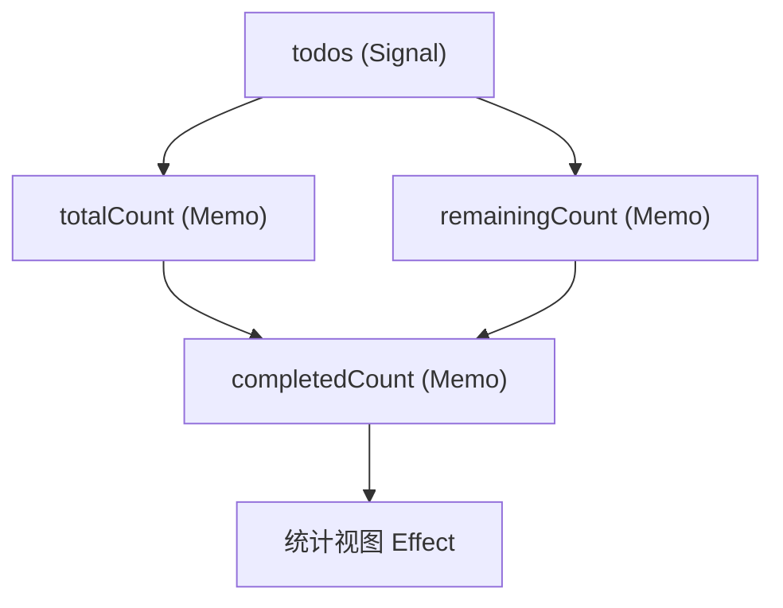

import BatchConsistencyDemo from "../../components/BatchConsistencyDemo";

在 [7.4](../7.4-todo-app/) 里，我们用自己写的 `nano-solid` 交付了一个完整的 Todo 应用。把框架真正放进真实应用后，两个藏在底层响应式内核里的隐蔽问题立刻浮出水面：

1. **一次用户操作连写多个 signal，观察者看到了半截中间态**：打开 `examples/todo-app/App.tsx` 的 `addTodo`，它依次调用了 `setTodos([...todos(), newTodo])` 和 `setDraft("")`；`startEdit` 也连续调用了 `setEditDraft(todo.text)` 和 `setEditingId(todo.id)`。在当前每次写入立刻同步通知的内核里，同时观察多个状态的 effect 会被连叫两遍，第一遍甚至读到“新任务已经加进列表，但草稿还没清空”的中间状态。下一章一旦接入 `localStorage` 持久化，保存 effect 就会把这种半截状态也写进磁盘。
2. **菱形依赖（Diamond Dependency）导致重复重算与瞬态毛刺（Glitch）**：看看 Todo 里的统计公式：

```ts
const totalCount = createMemo(() => todos().length);
const remainingCount = createMemo(() => todos().filter((todo) => !todo.completed).length);
const completedCount = createMemo(() => totalCount() - remainingCount());
```

这四个节点构成了一张经典的菱形依赖图：



当 `todos` 新增一条**未完成**任务时，`totalCount` 从 `3` 变成 `4`，`remainingCount` 从 `2` 变成 `3`，真实的 `completedCount` 本应纹丝不动（一直是 `1`）。但在第七章基于普通 `createEffect` 的朴素 `createMemo` 里，`totalCount` 沿着左边先通知 `completedCount` 时，`remainingCount` 还没来得及更新，于是下游会短暂算出一笔完全错误的 `4 - 2 = 2`，紧接着右边到达后才又跳回 `4 - 3 = 1`。这种中间出现的错误派生值就叫**毛刺（Glitch）**。

点击下面演示中的**新增未完成任务**按钮，对比 7.4 旧版内核的实测轨迹和本章目标（右侧由真正的 SolidJS 驱动）：

<BatchConsistencyDemo label="第八章预期效果：批量更新与菱形依赖无毛刺对比" client:load />

这一章分四小节把 `src/reactive.ts` 升级为工业级的细粒度响应式内核：

- **8.1 批量更新 `batch`**：引入嵌套批处理计数与同步刷新队列，把同一操作内的多次 signal 写入合并为一次集中通知，并改造 Todo 应用中的成组写入。
- **8.2 三态 Push-Pull 依赖图、菱形消毛刺与 `untrack`**：把 `createMemo` 升级为带 `CLEAN / CHECK / DIRTY` 三态和版本号的独立图节点，彻底消除菱形毛刺并让 `batch` 内读 memo 随时拿到最新一致值，同时导出 `untrack`。
- **8.3 重入保护、死循环熔断与异常恢复**：处理 effect 写回自身依赖的重入排队、按单计算计数的 `MAX_UPDATES` 死循环熔断、memo 循环依赖报错以及异常后的队列状态恢复。
- **8.4 惰性求值 `createMemo(compute, { lazy: true })`**：支持按需延迟计算的惰性 memo，无人读取时不白算，并在 Todo 应用中落地可折叠的按需派生明细。
