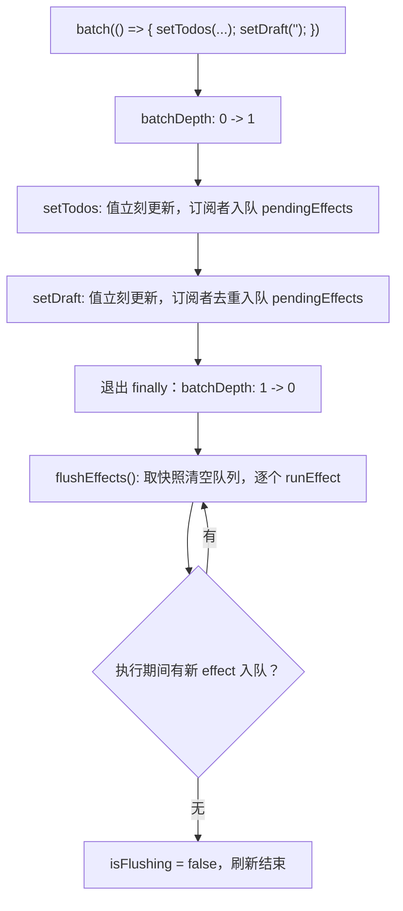

import LessonSolution from "../../components/LessonSolution.astro";

打开 [7.4](../7.4-todo-app/) 写好的 `examples/todo-app/App.tsx`，看看添加任务和进入编辑态这两段代码：

```ts
const addTodo = () => {
  // ...
  setTodos([...todos(), { id, text, completed: false }]);
  setDraft("");
  composerInput?.focus();
};

const startEdit = (todo: Todo) => {
  setEditDraft(todo.text);
  setEditingId(todo.id);
};
```

这两组操作在业务上都是**一个不可分割的动作**，但底层各自连续写了两个 signal。由于当前 `createSignal` 里的 `set` 每次写入都会立刻遍历 `subscribers` 同步执行 `runEffect`，任何同时读取 `todos()` 和 `draft()` 的观察者都会在 `addTodo` 期间被连续唤醒两次：第一次看到“任务已经加上、草稿还没清空”的中间态，第二次才看到终态。

这一节我们引入 `batch(fn)`，把同一批同步写入的通知收拢成一次集中刷新。

## 用嵌套计数与去重队列实现 `batch`

要合并多次写入的通知，核心思路非常直接：**写入照旧立刻落进闭包，只把“执行订阅者”这件事推迟到最外层 `batch` 退出时统一处理**。

我们在 `src/reactive.ts` 引入三个模块级状态：

- `batchDepth = 0`：记录当前嵌套了几层 `batch`。进入 `batch` 时加 `1`，退出时减 `1`。只有减回 `0` 时，才说明最外层批次真正结束。
- `pendingEffects = new Set<Effect>()`：暂存本轮等待执行的 effect。使用 `Set` 可以天然去重，同一个 effect 即使被 `setTodos` 和 `setDraft` 各唤醒一次，队列里也只保留一条。
- `isFlushing = false`：标记当前是否正处在 `flushEffects()` 循环里，防止某个 effect 内部再次写入 signal 时递归嵌套启动第二轮刷新。



## 必须兜住的四个细节

把队列跑通只需要十几行代码，但工程上要顺手兜住下面四个边界：

1. **批次内读 signal 永远立刻拿到新值**：`set(next)` 依然第一时间更新闭包 `value = next`，推迟的只是 `flushEffects()`。因此 `batch` 内部在 `setDraft("")` 之后立刻读 `draft()`，拿到的一定是 `""`。
2. **`flushEffects()` 要用 `while (pendingEffects.size > 0)` 循环**：某一个 effect 运行时可能会写入别的 signal，把新的 effect 放进 `pendingEffects`。由于此时 `isFlushing` 为 `true`，新入队的 effect 不会立刻递归执行，而是在当前快照跑完后由外层 `while` 循环接着消费，直到整个队列清空。
3. **被释放的 effect 及时移出队列**：如果排在前面的 effect 在刷新途中调用了 `dispose()` 释放排在后面的 effect，我们既在 `effect.onDispose` 里执行 `pendingEffects.delete(effect)`，又在 `runEffect` 入口保留 `if (effect.disposed) return;` 检查，确保已释放节点绝不会再运行。
4. **异常不能把调度器锁死，且保留最原始的异常**：
   - 如果 `flushEffects()` 执行某个 effect 时抛错，必须在 `catch` 里 `pendingEffects.clear()` 清理残余队列，并在 `finally` 里恢复 `isFlushing = false`，否则后续所有 signal 写入都会被永久卡死。
   - 如果 `batch(fn)` 的回调在写入部分 signal 之后抛错，我们在 `finally` 里递减 `batchDepth`，到达最外层时仍然刷新已写入的状态让画面保持一致；如果这次刷新自己又抛了错，要优先把最初的回调异常原样抛给调用方，避免掩盖真正根因。

> [!NOTE]
> 留一个小伏笔：试想在当前版本里，如果在 `batch` 回调中途写入 `setCount(10)`，再立刻读取第七章写的 `doubled()`（`createMemo`），会读到什么？
>
> 因为第七章的 `createMemo` 内部只是一个普通 `createEffect`，它的重算也被 `batch` 推迟到了批次结束之后，所以此时 `doubled()` **还会读到旧缓存**！等下一节 8.2 我们把 `createMemo` 升级为独立的三态 Push-Pull 图节点后，这个问题会连同菱形依赖毛刺一起彻底解决。

> [!PRACTICE]
>
> ```sh
> git switch -c solve/8.1 8.1-learn
> ```
>
> `src/reactive.ts` 与 `src/index.ts` 已声明并导出 `batch`，`src/reactive.test.ts` 新增了 5 条 `it.skip` 测试，覆盖多写入合并与批次内读新值、嵌套 `batch` 与返回值透传、回调抛错后的刷新与原始异常保留、刷新中释放已排队 effect 以及刷新抛错后的队列恢复。补齐 `src/reactive.ts` 中的 `flushEffects`、`batch` 与 `createSignal` 入队刷新逻辑，并把 `examples/todo-app/App.tsx` 中 `addTodo`、`removeTodo`、`startEdit`、`saveEdit` 的多信号写入用 `batch` 包裹（焦点操作留在 `batch` 外），确保 `pnpm format && pnpm check && pnpm test:run` 全部通过。

<LessonSolution slug="8.1-batch" tag="8.1-solution" />
