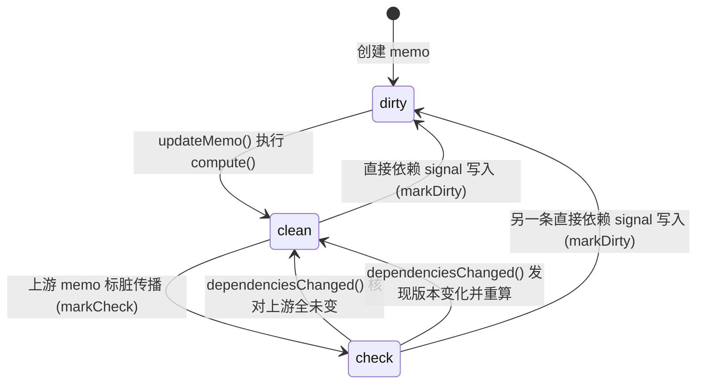

import LessonSolution from "../../components/LessonSolution.astro";

在 [8.1](../8.1-batch/) 末尾我们留下了两个必须一起解决的根源问题：

1. **菱形依赖毛刺（Glitch）**：当 `todos` 同时驱动 `totalCount` 和 `remainingCount`，再汇聚到 `completedCount = totalCount() - remainingCount()` 时，单次写入如果沿着依赖边立刻向下推送重算，先到达的那条路径会带着另一条路径的旧缓存算出错误结果（例如新增未完成任务时已完成数短暂闪成 `2` 再落回 `1`），还会让下游白跑多遍。
2. **`batch` 中途读 `createMemo` 拿到旧缓存**：因为旧版 `createMemo` 只是包了一层 `createEffect`，在 `batch` 里写入 `setCount(10)` 后立刻读 `doubled()`，重算被推迟到了批次结束，读到的依然是旧值。

这两个现象其实指向同一个本质缺陷：**纯 Push（写入时沿边立刻重算）不知道下游的另一条上游路径是不是也脏了，也无法在读取时按需拉取最新值**。这一节我们把 `createMemo` 升级成响应式图中的一等公民，用工业界广泛采用（SolidJS 1.x 与 TC39 Signals 草案同源）的 **Push-Pull 三态算法**彻底解决这两个问题，并补上非追踪读取原语 `untrack`。

## 为什么选择三态 Push-Pull + 版本号？

先从算法角度对比三种响应式求值策略：

| 策略                        | 写入开销             | 读取开销                    | 菱形依赖毛刺        | 关键代价或收益                           |
| --------------------------- | -------------------- | --------------------------- | ------------------- | ---------------------------------------- |
| 纯 Push（写入即重算）       | 高（立刻级联计算）   | `O(1)`                      | **有毛刺 / 重复算** | 要消毛刺必须维护动态拓扑排序             |
| 纯 Pull（读取时全图重查）   | `O(1)`               | 高（递归检查整张子图）      | 无毛刺              | 每次读都要回溯祖先，无脏标记剪枝         |
| **三态 Push-Pull + 版本号** | 仅传播轻量的状态标记 | 干净时 `O(1)`，脏时按需重算 | **彻底无毛刺**      | 无需复杂拓扑排序，每个节点每轮至多算一次 |

核心思想非常清晰：**把“标记可能过期（Push）”和“真正重新计算（Pull）”拆成两步**。

为此，每个上游数据源（`signal` 和 `memo` 共同实现 `Source`）都维护一个单调递增的整数 `version`，每次计算节点读取上游时，`track(source)` 不仅登记订阅边，还把此刻读到的 `source.version` 存进 `computation.dependencies: Map<Source, number>`。同时，每个 `Memo` 节点维护三种明确状态：

- **`clean`**：缓存是新鲜的，读取直接返回 `memo.value`（`O(1)`）。
- **`dirty`**：至少有一个直接依赖的 `signal` 已经变了，读取或刷新时必须立刻重算。
- **`check`**：上游的某个 `memo` 变脏了，但那个 `memo` 重算后结果**未必真变**（比如经 `Object.is` 同值截断了）。因此当前节点先标为 `check`，等到真正要读它时，再去拉取并核对上游版本号；如果所有上游版本都没变，直接切回 `clean` 零重算跳过。



## 用 Todo 菱形图走一遍两阶段推演

回到 `todos -> totalCount & remainingCount -> completedCount -> effect` 这张图。初始时 `todos` 有 1 项已完成、2 项未完成，四个节点版本号均为 `0`、状态全为 `clean`。现在调用 `setTodos([...todos(), newActiveTodo])`：

1. **阶段 1（Push 标脏，零计算）**：
   - `todos.version` 从 `0` 递增到 `1`。
   - `markDirty(totalCount)` 把 `totalCount` 标为 `dirty`，再对它的下游调用 `markCheck(completedCount)`，把 `completedCount` 标为 `check`，继续向下把 `effect` 放进 `pendingEffects`。
   - `markDirty(remainingCount)` 把 `remainingCount` 标为 `dirty`，再调用 `markCheck(completedCount)`，因为 `completedCount` 已经是 `check` 直接返回。
   - 至此 Push 结束，**一行 `compute()` 都没执行，不可能出现毛刺**。
2. **阶段 2（Pull 按需核对与重算）**：
   - `flushEffects()` 准备执行 `effect` 前，先调用 `dependenciesChanged(effect)`。
   - 它看到 `effect` 依赖了 `completedCount`（版本号快照为 `0`），于是调用 `updateMemo(completedCount)`。
   - `completedCount` 处于 `check`，进入 `dependenciesChanged(completedCount)`，按读取顺序先检查 `totalCount`：
     - 调用 `updateMemo(totalCount)`，`totalCount` 是 `dirty`，重算得 `4`，结果变化，`totalCount.version` 递增为 `1`，状态切回 `clean`。
     - `totalCount.version (1) !== 0`，立刻短路返回 `true`！
   - `completedCount` 确认上游真变了，调用 `runComputation(completedCount)` 执行 `totalCount() - remainingCount()`：
     - 读 `totalCount()`：已是 `clean`，直接拿 `4`；
     - 读 `remainingCount()`：此时处于 `dirty`，`updateMemo(remainingCount)` 立刻重算得 `3`，`remainingCount.version` 递增为 `1`，切回 `clean` 后返回 `3`；
     - 算出 `4 - 3 = 1`，与旧缓存 `1` 经 `Object.is` 判定相同，因此 `completedCount.version` **保持 `0` 不变**！
   - 回到 `dependenciesChanged(effect)`：核对 `completedCount.version (0) === 0`，返回 `false`！**下游 `effect` 根本不用重跑**。

顺带再看一眼 `batch` 中途读 `doubled()` 的场景：`setCount(10)` 已经在 Push 阶段把 `doubled` 标成 `dirty`，随后在 `batch` 内部显式调用 `doubled()` 时，getter 入口第一句就是 `updateMemo(memo)`，于是立刻按需重算拿到 `20` 并把状态置回 `clean`；等退出 `batch` 刷新时，`doubled` 已是干净状态，既不会重复计算，下游 `effect` 也照样只等批次结束执行一次。

## 两个容易忽略的工程细节

1. **为什么 `flushEffects()` 要先消费 `pendingEffects`，再消费 `pendingMemos`？**
   设想你在 `batch` 里同时隐藏分支并清空数据：`batch(() => { setShow(false); setUser(null); })`，而分支内部有一个急切求值的 `userName = createMemo(() => user()!.name)`。如果 `flushEffects()` 先跑 `pendingMemos`，`userName` 就会在外层 `<Show>` 来得及销毁它之前对 `null` 求值崩溃（经典的孤儿节点 / Zombie Child 问题）。先消费 `pendingEffects`，外层控制流会先销毁退出分支并把 `userName` 从 `pendingMemos` 中摘掉；而存活分支里用到的 memo 也会被 `dependenciesChanged` 顺手拉取变干净，最后轮到 `pendingMemos` 时只需补刷无人订阅的独立急切 memo。
2. **`untrack(fn)` 暂停哪些事？**
   假如 effect 读到 `count() === 0`，随后在 `untrack` 里写入 `1`。这次写入仍会把 effect 排进队列，但调度器要等当前这一轮执行结束，再让它读到 `1`。如果为了暂停追踪就清空 `currentComputation`，调度器会误以为当前没有计算在执行，提前刷新队列。

   我们用 `tracking` 控制读值登记，保留 `currentComputation` 和 `currentOwner`。如果在 `untrack` 里启动新的 effect，它那一轮会重新开启追踪，退出后再恢复外层的开关。

> [!NOTE]
> `dependenciesChanged` 按 `Map` 的插入顺序（也就是上一轮代码的实际读取顺序）核对依赖，并在发现第一个版本变化的上游时立刻 `return true` 短路。对于 `() => flag() ? heavyA() : heavyB()` 这类条件派生，当 `flag` 变化时短路能避免再去无谓地拉取即将退出分支的 `heavyA`。

> [!PRACTICE]
>
> ```sh
> git switch -c solve/8.2 8.2-learn
> ```
>
> `src/reactive.ts` 已升级好 `Source` / `Memo` / `Effect` 图节点结构、`track` 与 `runComputation`，并在 `src/index.ts` 导出了 `untrack`。`src/reactive.test.ts` 新增了 7 条 `it.skip` 测试，覆盖两种注册顺序的 Todo 菱形依赖、同 effect 读源值与 memo、`batch` 中途按需读 memo、孤儿分支安全释放以及 `untrack` 保留 Owner 和写入顺序。补齐 `src/reactive.ts` 中的 `markCheck`、`markDirty`、`dependenciesChanged`、`updateMemo`、`flushEffects` 与 `untrack`，确保 `pnpm format && pnpm check && pnpm test:run` 全部通过。

<LessonSolution slug="8.2-diamond-and-untrack" tag="8.2-solution" />
