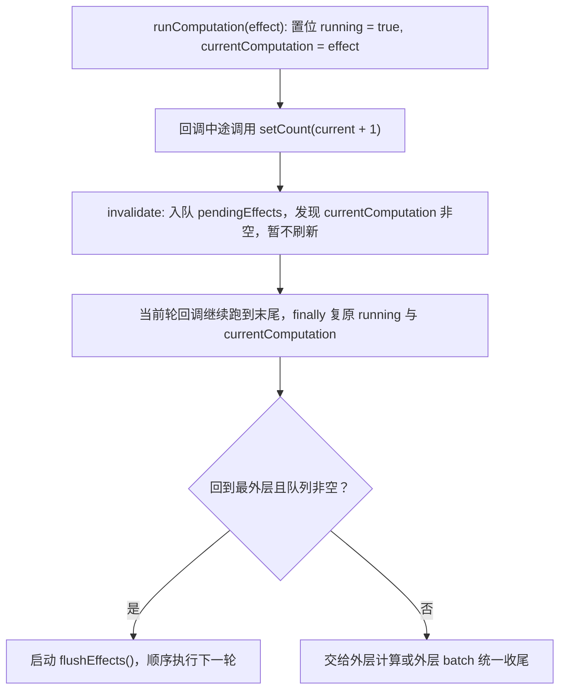

import LessonSolution from "../../components/LessonSolution.astro";

到 [8.2](../8.2-diamond-and-untrack/) 为止，只要计算函数只做“读取上游 -> 渲染或派生”，三态 Push-Pull 内核已经非常稳健。但真实业务里经常会出现三类棘手场景：

1. **effect 在执行途中写回自己依赖的 signal**（例如把非法输入自动钳制到 `[0, 100]`，或根据当前状态同步修正另一个字段）；
2. **代码不小心写出无限循环写回**（单个 effect 持续 `setCount(count() + 1)`，或者两个 effect 互相写回形成乒乓死循环）；
3. **派生状态写出了循环依赖**（`memoA` 读 `memoB`，`memoB` 又反过来读 `memoA`，或者 `memo` 自己读自己）。

如果内核对这三种情况不做保护，轻则打乱 `onCleanup` 执行顺序，重则把浏览器主线程彻底卡死或炸穿调用栈。这一节我们在不增加任何新公共 API 的前提下，把这三道安全阀全部焊进 `src/reactive.ts`。

## 1. 为什么不能在计算执行期间直接触发 `flushEffects()`？

看看下面这段再普通不过的收敛写回代码：

```ts
const [count, setCount] = createSignal(0);

createEffect(() => {
  const current = count();
  console.log("start", current);
  onCleanup(() => console.log("cleanup", current));
  if (current < 2) {
    setCount(current + 1);
  }
  console.log("end", current);
});
```

上一节已经让写入等当前计算结束再刷新。这段代码会先打印 `start 0`、`end 0`，再清理第 0 轮并运行第 1 轮。这里还需要给每个计算加上 `running`，因为 memo 读取会直接拉取上游，可能在一轮还没结束时再次进入同一个计算。



保持现有的排队规则，再为每个计算节点加上 `running: boolean` 标记。

- `runComputation` 入口检查 `if (computation.disposed || computation.running) return;`；
- 执行期间置 `computation.running = true`，并在 `finally` 中复原为 `false`；
- 等**最外层** `runComputation` 正常退出（`!currentComputation && batchDepth === 0 && !isFlushing`）且队列非空时，再统一调用 `flushEffects()` 顺序消费刚才排进去的写回任务。

这样每一轮 `start -> end -> cleanup -> 下一轮 start` 永远严格平铺展开，绝不嵌套交错。

## 2. 按“单个计算节点”计数的 `MAX_UPDATES` 熔断

既然允许 effect 写回并排队到本轮 `flushEffects()` 的下一次迭代，我们就必须兜住无限写回死循环：

```ts
const MAX_UPDATES = 100;
```

这里有一个很容易写错的架构细节：**计数器绝对不能是整个 `flushEffects()` 共享的一个全局整数 `totalRuns`，而必须是 `Map<Computation, number>`，按每个计算节点分别计数**。

原因很简单：假设 Todo 列表里有 150 条待办，用户点击“全部标记已完成”，这一轮刷新会唤醒 150 个彼此独立的行渲染 effect，每个只运行 **1 次**。如果用全局计数器一刀切在 100 次就抛错，正常的大列表立刻会被误杀；而按单计算节点计数时，这 150 个 effect 的计数都是 `1`，可以轻松全部通过；只有真正陷入自写回或 `A <-> B` 乒乓死循环的计算节点会在单轮冲破 `100` 次并精准触发熔断，抛出 `Error("Maximum reactive update depth exceeded")`。

## 3. 循环 `createMemo` 检测与异常后的状态恢复

与 effect 排队写回不同，memo 求值是同步拉取的：如果 `memoA` 在计算过程中又直接或间接读取了正在计算中的 `memoA`，无论重算多少次都不可能收敛。

有了 `running: boolean` 之后，循环检测只需要在 `updateMemo(memo)` 入口加两行：

```ts
if (memo.running) {
  throw new Error("Circular memo dependency detected");
}
```

哪怕是动态切入的互引用环（`flag` 变为 `true` 后 `memoA` 读 `memoB`、`memoB` 又读 `memoA`），也会在第一时间抛出明确的循环依赖错误，而不是把 JavaScript 引擎跑成模糊的 `RangeError: Maximum call stack size exceeded`。

最后统一检查异常恢复契约：

- 计算回调本身抛错（或触发循环 memo 抛错）：`runComputation` 的 `catch` 调用 `disposeOwner(computation, [])` 释放半截订阅与子作用域；如果当前处于最外层计算（不在 `flushEffects` 也不在 `batch`），同步清空 `pendingEffects` 和 `pendingMemos`，防止半截写回泄漏到下一次操作。
- 刷新期间死循环熔断或子计算抛错：`flushEffects` 的 `catch` 清空 `pendingEffects` 和 `pendingMemos`，`finally` 复原 `isFlushing = false`，确保后续无关状态的更新依然完全正常工作。

> [!PRACTICE]
>
> ```sh
> git switch -c solve/8.3 8.3-learn
> ```
>
> `src/reactive.ts` 已在 `ComputationBase` 补齐 `running: boolean` 字段并声明 `MAX_UPDATES = 100`，`src/reactive.test.ts` 新增了 6 条 `it.skip` 测试，覆盖收敛写回与 `onCleanup` 顺序、effect 内嵌套 `batch`、120 个独立 effect 同轮不误熔断、单 effect 无限自写回熔断、双 effect 乒乓死循环熔断，以及自引用与互引用循环 `createMemo` 报错清理。补齐 `src/reactive.ts` 中的重入保护、环检测、单节点计数熔断与最外层写回刷新逻辑，确保 `pnpm format && pnpm check && pnpm test:run` 全部通过。

<LessonSolution slug="8.3-reentrancy-and-cycles" tag="8.3-solution" />
