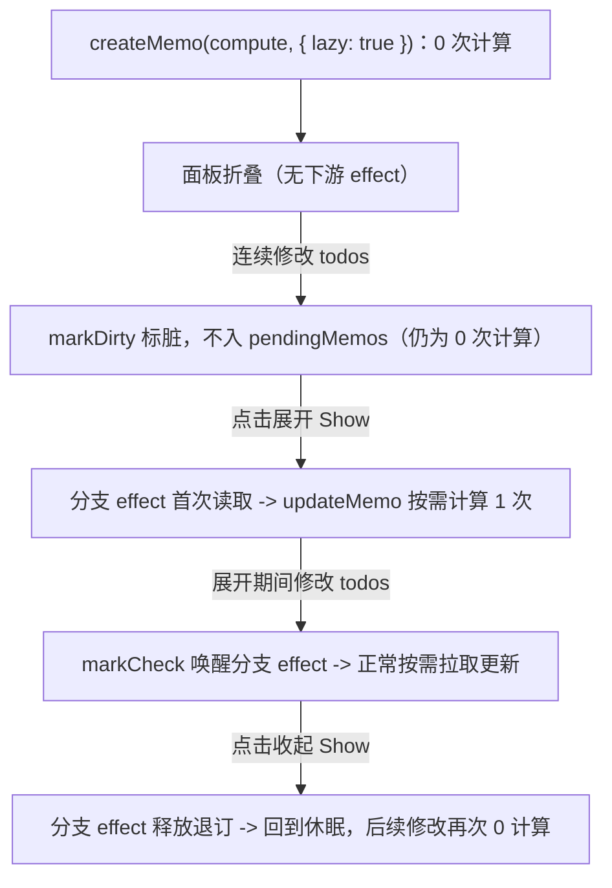

import LessonSolution from "../../components/LessonSolution.astro";

到 [8.3](../8.3-reentrancy-and-cycles/) 为止，我们的三态 Push-Pull `createMemo` 默认采用**急切求值（eager）**：创建时立刻算出初值，每次上游 signal 变化并在 `flushEffects()` 收尾时也会把独立 memo 一并补刷到最新。

默认急切求值的好处很明显：语义和第七章完全一致，初始化时的逻辑错误会第一时间暴露，也不容易让读者在调试时意外看到“还没算”。但在真实应用里，还有另一类高频场景：

- 页面里有一个**默认折叠的详情面板**（比如 Todo 底部的“已完成任务明细”）、隐藏的弹窗、或者只有用户点“导出报告”才会读取的重计算摘要；
- 面板折叠期间，用户不断新增、勾选、编辑待办事项，如果这个派生依然每次都急切重算，CPU 就在白白做根本没人看的无用功。

这一节我们给 `createMemo` 增加一个可选配置 `createMemo(compute, { lazy: true })`，把三态 Push-Pull 架构里原本就具备的“按需拉取”能力彻底释放出来。

## 为什么只需要改三处就能长出惰性求值？

因为我们在 [8.2](../8.2-diamond-and-untrack/) 已经把 Push（标脏）和 Pull（按需刷新）彻底拆开了！要支持 `{ lazy: true }`，只需要在 `Memo` 节点上记录 `eager = !(options?.lazy ?? false)`，再调整三处小边界：

1. **创建时跳过首次求值**：只有 `memo.eager` 为 `true` 时，才在 `createMemo` 内部立刻调用 `updateMemo(memo)`。惰性 memo 创建后停留在 `initialized = false`、`state = "dirty"`，计算次数为 `0`。
2. **Push 阶段只标脏、不入 `pendingMemos`**：在 `markDirty` 和 `markCheck` 里，只有 `computation.eager` 为 `true` 时才把 memo 放进 `pendingMemos`。注意它**依然会把 `dirty` / `check` 沿着下游传给活跃的 `effect`**：
   - 如果此时没有活跃 `effect` 订阅它（例如 `<Show>` 处于折叠态），上游改 100 次，它也只会停留在 `dirty`，执行 `0` 次重算；
   - 一旦 `<Show>` 展开挂载了读取它的 `effect`，展开瞬间会拉取算 1 次，展开期间上游变化也会通过 `effect` 自动拉取保持同步；
   - 等 `<Show>` 再次收起销毁分支 `effect`，它的 `subscribers` 变空，又会自动回到“上游怎么改都不白算”的休眠状态！
3. **兜住“未求值先释放”的边界**：如果一个惰性 memo 已经读过一次再随 `Owner` 释放，后续再读沿用既有规则返回最后一次缓存；但如果它**一次都没读过就被父作用域释放了**，此刻 `memo.value` 根本没有有效值，直接抛出明确错误 `Error("Cannot read a lazy memo that was disposed before its first evaluation")`，避免悄悄返回伪造的 `undefined`。



## 在 Todo 应用里落地按需派生明细

在 `examples/todo-app/App.tsx` 底部，我们用 `createMemo(..., { lazy: true })` 派生一份 `completedDetails`（把全部已完成任务的标题拼成明细文案），再配合一个折叠开关 `#toggle-completed-details` 和 `<Show when={showCompletedDetails}>` 展示 `#completed-details`。折叠期间勾选或新增任务不会白算，点击展开立刻呈现最新明细并在展开期间保持同步。

> [!PRACTICE]
>
> ```sh
> git switch -c solve/8.4 8.4-learn
> ```
>
> `src/reactive.ts` 与 `src/index.ts` 已声明并导出 `MemoOptions`，`src/reactive.test.ts` 新增了 5 条 `it.skip` 测试，覆盖未读零计算、随 effect 挂载/释放切换活跃与休眠、链式惰性同值截断、首次读取抛错清理以及“未求值先释放”报错；`examples/todo-app/App.test.tsx` 也新增了 1 条 `it.skip` 端到端测试。补齐 `src/reactive.ts` 中的惰性求值逻辑，并在 `examples/todo-app/App.tsx` 底部接入由 `{ lazy: true }` 驱动的可折叠已完成明细，确保 `pnpm format && pnpm check && pnpm test:run && pnpm build` 全部通过。

<LessonSolution slug="8.4-lazy-memo" tag="8.4-solution" />
