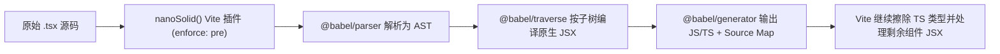

import CompilerCompareDemo from "../../components/CompilerCompareDemo";

到 [8.4](../8.4-lazy-memo/) 为止，`nano-solid` 已经拥有完整的细粒度响应式内核（`createSignal`、`createEffect`、`createMemo`、`batch`、`untrack`、`createRoot`、`onCleanup`）、控制流（`<Show>`、`<For>`）以及原生 `Node` 渲染模型。

不过如果你回头看第五章接入的 JSX 链路，会发现离真正的 SolidJS 还差最后一块最标志性的拼图：**编译期优化**。目前我们的 `.tsx` 文件还是交给 TypeScript / Vite 的通用 `react-jsx` 转换，把每个 `<button>`、``、`<li>` 编成 `jsx("button", { class: ..., children: [...] })`：

- 明明在写代码那一刻我们就知道 `"button"` 是原生 HTML 标签、`id="add-todo"` 是静态字符串、`"添加"` 是静态文本，却还要在每次运行时构造一个临时 `props` 对象、分配 `children` 数组、遍历属性键做动态分派，再把子节点丢进 `normalizeChildren` 里层层判断类型；
- 真正的 SolidJS 会在**编译期**分析 JSX 的抽象语法树（AST），把编译期就能确定的原生标签、静态文本、已知属性和响应式绑定直接翻译成精准的原生 DOM 指令，只把真正动态或组件级的内容留给运行时处理。

这一章我们就亲手写出自己的 **JSX 编译器与 Vite 插件**，把 `nano-solid` 的框架 MVP 彻底闭环：

切换下面演示中的三组样例，直观对比同一段 TSX 在第五章运行时模式与第九章编译模式下的输出差异：

<CompilerCompareDemo label="第九章预期效果：JSX 编译前后输出对比" client:load />

这一章分四小节把整条编译链路搭起来，并严格守住一条铁律：**开启编译器与关闭编译器（纯运行时回退）对同一份 TSX 必须产生 100% 等价的 DOM、求值顺序、异常回滚与卸载清理行为**。

- **[9.1 从 JSX 到直接 DOM 调用](../9.1-static-jsx-compiler/)**：引入 Babel 8.x（`@babel/parser` / `traverse` / `generator` / `types`），实现 `transformJSX(source, options?)`，先编译静态小写原生标签、静态文本（对齐 JSX 空白规则）与嵌套结构，组件与未支持写法保留 JSX 交由运行时兜底。
- **[9.2 编译子节点与按需注入辅助函数](../9.2-children-and-runtime/)**：新建 `src/compiler-runtime.ts`，把确定的函数子节点 `{() => ...}` 编译为 `createReactiveText`，把不确定类型的表达式交给 `appendChildren` 复用 `normalizeChildren`，并用 `generateUidIdentifier` 按需单次注入无命名冲突的 `import`。
- **[9.3 编译属性、事件、`ref` 与混合树](../9.3-props-events-and-hybrid/)**：把静态属性直出为原生赋值或 `setAttribute`，动态属性、受控表单（`value`、`checked`、`disabled`、`aria-label`）和事件（`onClick` / `onInput` / `onChange` + `onCleanup`）按既有顺序绑定并在抛错时沿 `Owner` 回滚，同时编译 `<Show>` / `<For>` 懒工厂内部的原生标签。
- **[9.4 编写 Vite 插件并用编译器跑通 Todo](../9.4-vite-plugin/)**：实现 `nanoSolid()` Vite 插件（`enforce: "pre"`、过滤资源查询、生成 source map），接入根目录 `vite.config.ts` 并用同一套 Todo 应用与等价性测试做双路径端到端验收。
