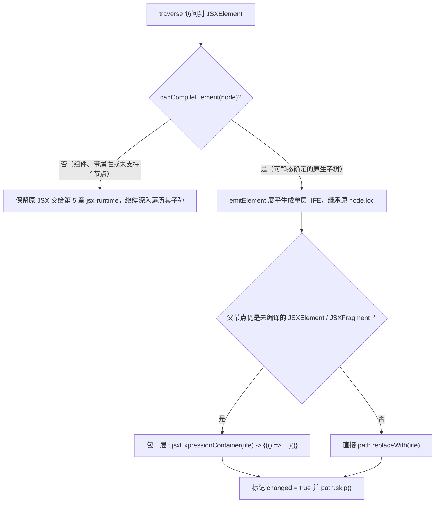

import LessonSolution from "../../components/LessonSolution.astro";

动手写编译器听起来很神秘，拆开看其实永远只有三步：**解析（Parse）→ 变换（Transform）→ 生成（Generate）**。

这一节我们先不碰动态表达式和属性绑定，只把最纯粹的**静态原生 HTML 标签、纯文本和嵌套结构**编译成直接 DOM 调用。比起急着堆功能，更重要的是把编译器背后几个最核心的设计决策（know-why）一次讲透，后面三节都会沿着同一套骨架生长。

## 1. 为什么编译结果必须包一层 IIFE，而且整棵子树只包一层？

初学者看到编译输出时，第一个问题往往是：为什么要写成一个看起来有点啰嗦的立即执行箭头函数 `(() => { ... })()`，不能直接生成几行 `const _el = ...` 吗？

原因来自 JavaScript 自身的语法边界：**JSX 在语法上永远是一个表达式（Expression），但创建并组装 DOM 节点需要多条语句（Statements）**。

看看你在真实代码里把 JSX 放在了哪些位置：

```tsx
const view = <button>添加</button>; // 变量右值
const label = ready ? <span>就绪</span> : <span>等待</span>; // 三元运算符分支
const items = [<li>一</li>, <li>二</li>]; // 数组元素
const Panel = () => (
  <div>
    <p>正文</p>
  </div>
); // 箭头函数简写返回值
```

这些位置全都是**表达式位置**，语法上绝不允许直接塞进 `const _el = document.createElement("span"); _el.appendChild(...);` 这样的多条语句。JavaScript 不像 Rust 那样拥有“块级表达式”（block expression），要把“建元素 + 塞子节点 + 返回根元素”这一组语句打包成**能在任意表达式位置求值的单个值**，同时把临时变量 `_el` 关在局部作用域里不污染外层代码，最标准、零运行时依赖的手段就是 **IIFE（Immediately Invoked Function Expression）**。

进一步看嵌套标签：

```tsx
<section>
  <h1>nano-solid</h1>
  <div>
    <span>编译期</span>
    <strong>直接 DOM</strong>
  </div>
</section>
```

如果每个子标签都各自包一层 `(() => { ... })()`，每多一层嵌套就会多分配一次闭包函数、多一次函数调用栈帧。但整棵静态子树其实只需要向外部交出**一个**根表达式，因此我们用递归辅助函数 `emitElement(element, scope, statements)` 把整棵子树展平放进同一个 `statements` 数组，最后只在最外层包**唯一一层 IIFE**：

```js
(() => {
  const _el = document.createElement("section");
  const _el2 = document.createElement("h1");
  _el2.appendChild(document.createTextNode("nano-solid"));
  _el.appendChild(_el2);
  const _el3 = document.createElement("div");
  const _el4 = document.createElement("span");
  _el4.appendChild(document.createTextNode("编译期"));
  _el3.appendChild(_el4);
  const _el5 = document.createElement("strong");
  _el5.appendChild(document.createTextNode("直接 DOM"));
  _el3.appendChild(_el5);
  _el.appendChild(_el3);
  return _el;
})();
```

> [!NOTE]
> **为什么本课程生成直接 `document.createElement`，而不是像真 SolidJS 那样编译成 `<template>` + `cloneNode(true)`？**
>
> 生产版 SolidJS（`babel-preset-solid`）会把整段静态 HTML 提到模块顶部拼成 `<template>`，运行时通过 `cloneNode(true)` 整块复制，再用 `firstChild / nextSibling` 链式寻址把动态绑定插回去。对大块静态模板而言 `cloneNode` 吞吐量更高，但需要额外套上 HTML 转义、SVG / `<table>` 特殊解析包裹以及路径寻址算法。
>
> 我们先用“扁平单 IIFE + 直接 `document.createElement`”：它已经彻底省掉了 `jsx()` 的 props 对象分配、动态键遍历和 `normalizeChildren` 递归，整份编译器清晰透明，和第 4、5 章手写 DOM 代码一一对应，能让你把 AST 编译与运行时等价性的核心原理彻底吃透。

## 2. 为什么选择 Babel 8.x，以及 `generateUidIdentifier` 解决了什么问题？

我们在 `package.json` 的 `dependencies` 中安装了四个 Babel 8.x 包（放在 `dependencies` 而不是 `devDependencies`，是因为第 10 章发布 `nano-solid/vite` 插件后，外部项目在 Vite 中运行我们的插件也需要它们）：

- **`@babel/parser`**：开启 `plugins: ["jsx", "typescript"]`，把 `.tsx` 源码解析成带行列位置（`loc`）的 AST；
- **`@babel/traverse`**：深度优先遍历 AST，提供作用域分析、节点替换 `path.replaceWith(...)` 与跳过子树 `path.skip()`；
- **`@babel/types`**：类型安全的 AST 节点守卫与工厂（`t.isJSXElement`、`t.callExpression`、`t.variableDeclaration` 等）；
- **`@babel/generator`**：把改写后的 AST 输出为代码字符串，并产出 `source map`。

写编译器时有两个很容易踩的 AST 细节：

- **生成变量名防撞车**：如果你自己维护一个自增计数器拼出 `_el1`、`_el2`，一旦用户的代码里本来就声明了 `const _el1 = ...`，编译产物就会直接报 `Identifier '_el1' has already been declared` 或意外遮蔽外部变量。调用 Babel 作用域提供的 `scope.generateUidIdentifier("el")`，它会自动扫描当前及外层作用域的全部绑定，保证生成的局部名 100% 不与用户代码冲突。
- **复用标识符时用 `t.cloneNode(id, true)`**：同一个局部名 `_el` 会出现在 `const _el = ...`、多次 `_el.appendChild(...)` 以及最后的 `return _el` 里。AST 是一棵树而不是有向无环图，如果把同一个 `Identifier` 对象引用直接挂进多个父节点，后续任何遍历或 source map 计算修改其中一处时都会互相串扰，因此每次引用都克隆一份独立节点。

## 3. 按子树混合编译：保留未支持 JSX 兜底与 `{...}` 包装规则

编译器不需要第一天就覆盖 100% 的 JSX 语法才能工作。我们采取**按子树判定 + 运行时兜底（Hybrid Compilation）**：



图里有两个关键细节：

1. **为什么父节点还是未编译 JSX 时必须套一层 `t.jsxExpressionContainer`？**
   看 `<Card><div>静态内容</div></Card>`：外层 `<Card>` 是函数组件，会被保留为 JSX，而内层的 `<div>` 会被编译成 IIFE。在 JSX 子节点语法里，只有放进 `{...}` 里的内容才会被当作 JavaScript 表达式求值；如果直接把 `CallExpression` 塞进 `JSXElement.children`，要么输出非法语法，要么在后续 JSX 转换中无法作为表达式解析。加上 `t.jsxExpressionContainer(iife)` 后，生成的是合法的 `<Card>{(() => { ... })()}</Card>`。
2. **为什么没有任何改写时必须返回 `null`，以及为什么要保留 `loc` 和 `source map`？**
   - 返回 `null` 是 Vite / Rollup `transform` 钩子的标准约定：明确告诉构建工具“这个文件没有改动”，省去多余的重解析与 source map 合并开销。
   - 把原 `JSXElement` 的 `loc` 挂到生成的 IIFE 与 `createElement` 节点上，并在 `generate` 开启 `sourceMaps: true`，才能在运行时抛错或打断点时把位置准确映回原始 `.tsx` 行号。

## 4. 严格对齐标准 JSX 空白折叠规则

在 JSX 里，同行空格和跨行缩进的处理规则完全不同，任何偏差都会导致编译版和运行时版的 `childNodes` 不一致：

- `<p>A    B</p>` 位于同一行，中间四个空格必须原样保留；
- 多行标签之间的纯换行缩进（`<div>\n  <span>...</span>\n</div>`）必须裁掉，不能多出空白 `Text` 节点；
- 显式写出的 `{" "}` 字符串字面量表达式必须保留为单个空格 `Text` 节点；
- `{/* 注释 */}` 在 AST 里表现为带 `JSXEmptyExpression` 的 `JSXExpressionContainer`，直接忽略。

我们在 `normalizeJSXText(raw)` 里按换行拆行：对非首行去掉前导空格与制表符，对非末行去掉尾随空格与制表符，过滤掉空行后用单个空格连接。这套算法与 Vite / Babel 默认的 `react-jsx` 转换完全一致。

> [!PRACTICE]
>
> ```sh
> git switch -c solve/9.1 9.1-learn
> ```
>
> Babel 8.x 依赖已安装，`src/compiler/transform.ts` 已搭建好 `TransformOptions`、`TransformResult` 与 `transformJSX` 解析/生成框架，`src/compiler/transform.test.ts` 新增了 6 条 `it.skip` 测试，覆盖静态标签编译、扁平单 IIFE 嵌套树、JSX 空白与注释规则、组件内混合子树编译、无改动返回 `null` 以及 `source map` 校验。补齐 `normalizeJSXText`、`canCompileElement`、`emitElement` 与 `JSXElement` 访问器，确保 `pnpm format && pnpm check && pnpm test:run` 全部通过。

<LessonSolution slug="9.1-static-jsx-compiler" tag="9.1-solution" />
