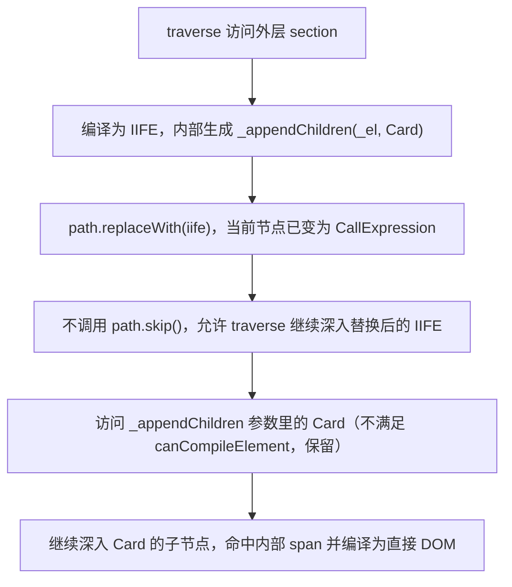

import LessonSolution from "../../components/LessonSolution.astro";

在 [9.1](../9.1-static-jsx-compiler/) 里，只要标签里出现一个 `{() => count()}`、`{label}` 或者 `<Card />`，整棵原生元素就被迫退回第 5 章的运行时 `jsx()`。真实组件里几乎每个元素都混着静态文本、动态值和子组件，这一节我们把**任意子节点**全部纳入编译范围，同时引入编译器专用的轻量辅助模块 `#nano-solid/compiler-runtime`。

动手改代码之前，先把四个决定编译器正确性的设计问题讲透。

## 1. 为什么 `{() => count()}` 与 `{count()}` 必须走两条不同的编译路径？

写响应式框架编译器，最容易犯的错是“自作主张改变语义”。先回头对照我们在第 5 章定下的运行时契约（`src/jsx-runtime.ts` 的 `normalizeChildren`）：

- 写成 `<p>{() => count()}</p>` 时，子节点是一个函数，`normalizeChildren` 把它交给 `createReactiveText` 建立响应式订阅，之后 `count` 变化会原地更新这个 `Text` 节点；
- 写成 `<p>{count()}</p>` 时，子节点是 `count()` 的**求值结果**（例如数字 `1`），`normalizeChildren` 只创建一次静态文本 `"1"`，之后 `count` 再变也不会重新计算。

> [!NOTE]
> **为什么这里不像真正的 SolidJS 那样自动把 `{count()}` 包成 `() => count()`？**
>
> 生产版 SolidJS 在语言层就把 JSX 表达式规定为默认响应式（所以关闭它的 Babel 插件后，代码本身就无法保持相同语义）。而在 `nano-solid` 里，从第 5 章到第 8 章我们一直遵循显式函数写法（`{() => count()}` 代表动态、`{count()}` 代表单次快照），而且我们的测试与 Todo 应用在不开编译器时也能靠 `jsx-runtime` 独立运行。
>
> 编译器在这里扮演的是**等价加速器**：开启编译器前后，同一份 `.tsx` 的求值次数、DOM 结构和响应式行为必须 100% 一致，绝不能悄悄把静态快照改成动态订阅。

顺着这条等价原则，我们把 `JSXElement.children` 按 AST 形态分成五类，各自走最精准的编译路径：

| 子节点写法                                              | AST 节点形态                                              | 编译输出                                                        | 为什么这么编                                                                                                                                                 |
| ------------------------------------------------------- | --------------------------------------------------------- | --------------------------------------------------------------- | ------------------------------------------------------------------------------------------------------------------------------------------------------------ |
| `hello`                                                 | `JSXText`                                                 | `_el.appendChild(document.createTextNode("hello"))`             | 编译期已确定静态文本，零运行时开销                                                                                                                           |
| `{/* 注释 */}` / `{" "}`                                | `JSXEmptyExpression` / `StringLiteral`                    | 跳过 / `document.createTextNode(" ")`                           | 编译期已知静态内容，无需辅助函数                                                                                                                             |
| `{() => count()}` / `{function () { return count(); }}` | 无参同步 `ArrowFunctionExpression` / `FunctionExpression` | `_el.appendChild(_createReactiveText(expr))`                    | 编译期已确定是响应式文本 getter，直接跳过 `normalizeChildren` 的类型分支                                                                                     |
| `{count()}` / `{0}` / `{items}` / `{getLabel}`          | 其他任意 `Expression`                                     | `_appendChildren(_el, expr)`                                    | 编译期无法判断运行时类型（可能是数字 `0`、`false`、`null`、嵌套数组、`Node`、`DocumentFragment` 或函数变量），交给 `appendChildren` 复用 `normalizeChildren` |
| `<span>...</span>` / `<Card />`                         | `JSXElement`                                              | 可编译则继续展平进同一 IIFE；否则 `_appendChildren(_el, child)` | 原生子树零开销展平；组件或暂未支持元素保留 JSX 交给运行时                                                                                                    |

这里还有一个容易忽略的细节：**为什么 `createReactiveText` 在 `compiler-runtime.ts` 里做 `String(getValue())`，而不是由编译器改写用户的箭头函数体？**

如果用户写的是简写箭头函数 `{() => count()}`，在 AST 里把函数体包成 `String(count())` 看似容易；但一旦用户写成块体箭头函数 `{() => { const n = count(); return n * 10; }}` 或普通函数 `{function () { return count(); }}`，编译器就得递归扫描所有 `return` 语句（同时避开嵌套函数里的 `return`），复杂度陡增。把 `String(getValue())` 收进 `src/compiler-runtime.ts` 的 `createReactiveText` 里，既能让编译产物直接原样透传用户函数、支持任意函数体写法，又跟 `src/jsx-runtime.ts` 第 50 行的行为分毫不差。

同理，`appendChildren(parent, child)` 直接复用从 `src/jsx-runtime.ts` 导出的 `normalizeChildren`，把数字 `0`、忽略布尔与空值、嵌套数组拍平、`Node` / `DocumentFragment` 插入以及函数变量 `{getLabel}` 统一收口到**唯一一份真相来源**，避免两套代码日后漂移。

## 2. 为什么单独拆出 `#nano-solid/compiler-runtime`，还要让路径可配置？

我们在 `package.json` 的 `"imports"` 新增了 `"#nano-solid/compiler-runtime": "./src/compiler-runtime.ts"`，让三个入口职责彻底分离：

- **`#nano-solid`**：给业务开发者手写导入的公共框架 API（`createSignal`、`createEffect`、`render`、`<Show>`、`<For>` 等）；
- **`#nano-solid/jsx-runtime`**：给 TypeScript / Vite 的自动 JSX 转换兜底使用；
- **`#nano-solid/compiler-runtime`**：专供我们自己的编译器在生成代码里自动注入的底层原语（9.2 放 `createReactiveText` 和 `appendChildren`，9.3 会继续放属性绑定与清理原语）。

把它们拆开后，业务侧不会在自动补全里误用仅供编译器调用的内部原语；同时在 `transformJSX(source, options)` 里保留 `options?.runtimeModule`（默认 `"#nano-solid/compiler-runtime"`），到第 10 章正式对外发布包时，只需把默认模块名切成 `"nano-solid/compiler-runtime"`，编译器主体一行都不用改。

## 3. 按需单次注入 `import` 与跨作用域防撞车

编译产物如果每个文件都无脑塞一条 `import { createReactiveText, appendChildren } from ...`，纯静态组件就会多出无用依赖，而且一旦同一文件里多处用到辅助函数，也不能重复插多条 `import`。

我们的做法是在 `transformJSX` 里维护一张整文件共享的登记表 `helperImports = new Map<RuntimeHelper, t.Identifier>()`：

1. **按需登记**：只有当 `emitElement` 真正生成 `_createReactiveText` 或 `_appendChildren` 调用时，才通过 `context.useHelper(name)` 索取它的局部标识符；纯静态文件里 `helperImports.size === 0`，**不生成任何 `import` 语句**。
2. **合并单次插入**：等到 `traverse` 触发 `Program.exit` 时，再把 `helperImports` 中的条目按辅助函数名排序，拼成**唯一一条** `import { appendChildren as _appendChildren, createReactiveText as _createReactiveText } from "..."`，调用 `programPath.unshiftContainer("body", importDecl)` 插到模块顶部（`"use strict"` 这类指令位于 `Program.directives` 而非 `Program.body`，因此 `unshiftContainer` 永远不会插到指令前面）。
3. **跨嵌套作用域防重名**：考虑下面这段带遮蔽的边界代码：

```tsx
const _createReactiveText = "outer";

function makeView() {
  const _appendChildren = "inner";
  return (
    <div>
      {() => count()}
      {suffix}
    </div>
  );
}
```

如果在 `Program.exit` 时把导入别名写死成 `_appendChildren`，`makeView` 内部的局部常量 `const _appendChildren = "inner"` 就会遮蔽顶层导入，运行时直接抛出 `TypeError: _appendChildren is not a function`。

解法是调用 `path.scope.getProgramParent().generateUidIdentifier(name)`。Babel 在开始遍历前会执行整棵 AST 的 `Scope.crawl()`，模块里**任何嵌套函数**声明或引用过的标识符都会登记进 `Program` 作用域的 `references` / `bindings` 中。因此 `programScope.generateUidIdentifier("appendChildren")` 会自动避开内层的 `_appendChildren`，直接生成 `_appendChildren2`，既不撞顶层名字，也不会被任意深度的局部变量遮蔽。

## 4. 为什么 9.2 必须去掉 `path.skip()`？

在 9.1 里，`canCompileElement` 要求整棵子树里**没有任何**未编译的 `JSXElement`，所以把根节点替换成 IIFE 后调用 `path.skip()` 是安全的。

但在 9.2，外层 `<div>` 可以包含尚未编译的子组件 `<Card>` 或暂不支持的 `<button id="later">`：



如果替换 `<section>` 后仍然调用 `path.skip()`，`traverse` 会直接跳过整段刚生成的 IIFE，导致挂在 `_appendChildren(_el, <Card><span>...</span></Card>)` 里的 `<span>` 彻底失去编译机会。去掉 `path.skip()` 后，因为 `<section>` 自身已经被替换成 `CallExpression`（或 `JSXExpressionContainer`），不会再次命中 `JSXElement` 造成死循环，同时 `traverse` 会自然走进 `_appendChildren` 的参数树，把 `<Card>` 和 `<button id="later">` 内部所有能编译的原生标签统统编完。

> [!PRACTICE]
>
> ```sh
> git switch -c solve/9.2 9.2-learn
> ```
>
> 本节已在 `package.json` 补上 `#nano-solid/compiler-runtime` 映射、在 `src/jsx-runtime.ts` 导出 `normalizeChildren`，并搭建了 `src/compiler-runtime.ts` 与 `src/compiler/transform.ts` 的 9.2 骨架；`src/compiler/transform.test.ts` 新增 6 条 `it.skip` 测试，覆盖响应式函数与静态快照等价性、边缘值子节点、按需单次导入与自定义 `runtimeModule`、跨作用域防撞车、嵌套混合子树编译以及构造中途抛错的 `Owner` 回滚。补齐全部 `// TODO` 并运行 `pnpm format && pnpm check && pnpm test:run`，确保全部 129 条测试通过。

<LessonSolution slug="9.2-children-and-runtime" tag="9.2-solution" />
