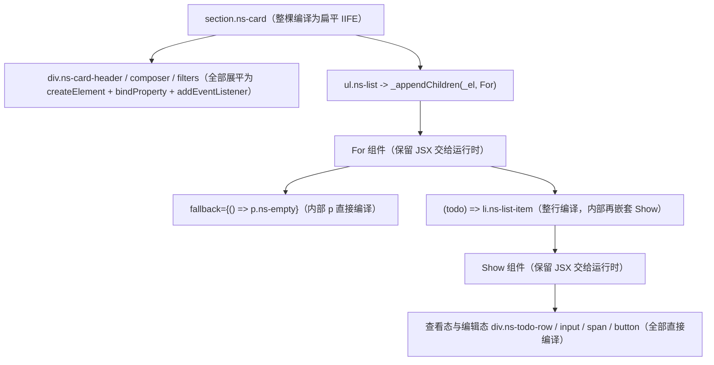

import LessonSolution from "../../components/LessonSolution.astro";

在 [9.2](../9.2-children-and-runtime/) 里，我们的编译器已经能处理任意子节点，但只要标签上出现一个 `class="ns-btn"` 或 `onClick={addTodo}`，整个元素就不得不退回运行时 `jsx()`。现实项目里几乎没有“光秃秃不带任何属性”的标签，这一节我们把属性、受控表单、事件监听与 `ref` 全部接入编译器，让整份 `examples/todo-app/App.tsx` 的所有原生标签彻底告别 `jsx()`。

同样地，写代码之前先把最容易踩坑的五个设计问题讲清楚。

## 1. 静态直出 vs `_bindProperty`，为什么不能把 `dom.ts` 的逻辑抄两遍？

观察 `examples/todo-app/App.tsx` 里的原生属性，它们天然分成两类：

- **编译期就能确定静态值与标签类型**：例如 `id="add-todo"`、`type="button"`、`class="ns-btn"`、`aria-label="新建待办事项"`、`<input placeholder="输入待办事项..." />`、`<button disabled>`、`<input checked />`。这些属性根本不需要进运行时函数，直接生成 `_el.id = "add-todo"`、`_el.className = "ns-btn"`、`_el.setAttribute("type", "button")`、`_el.disabled = true`，**零额外 import、零分支判断**。
- **运行期才能确定值，或者需要跨标签校验**：例如 `class={() => ...}`、``id={`todo-${todo().id}`}``、`value={() => draft()}`、`checked={() => todo().completed}`、`disabled={() => ...}`，以及误写在非目标标签上的 `<div disabled={true} />`。

为什么动态的 `id={maybeId}` 不能直接编成 `_el.id = maybeId`？因为如果 `maybeId` 在运行时是 `undefined`，原生 DOM 会把它强制转成字符串 `"undefined"` 写进元素属性；而 `dom.ts` 的规则是 `undefined` 时跳过写入。同样地，`value` 写入前必须检查 `if (element.value !== next)` 以保护用户输入光标，表单属性是否适用于元素，继续按运行时的规则校验。

为了彻底杜绝“运行时改了一处，编译器漏改一处”的漂移，我们在 `src/dom.ts` 中把这 8 个属性的校验与绑定收口成唯一的公共函数 `applyElementProperty(element, prop, value)`：`createElement` 与 `src/compiler-runtime.ts` 的 `bindProperty` 共用同一份实现。编译器只需负责把能静态确定的走直出快路径，其余统一生成 `_bindProperty(_el, prop, expr)`。

## 2. 事件编译里的经典内存泄漏陷阱：为什么必须先存临时变量 `_h`？

看到 `<button onClick={() => setFilter("all")}>全部</button>`，最直觉的编译写法可能是这样：

```js
// 错误示范：addEventListener 和 removeEventListener 传入了两个不同的函数实例！
_el.addEventListener("click", () => setFilter("all"));
_onCleanup(() => _el.removeEventListener("click", () => setFilter("all")));
```

这段代码不会报任何语法错误，却藏着一个隐蔽的内存泄漏：JavaScript 里每次执行 `() => setFilter("all")` 都会分配一个**全新的函数对象**，卸载时 `removeEventListener` 拿到的引用跟注册时根本不是同一个函数，监听永远删不掉。

另外，如果用户写的是 `<button onClick={makeHandler()}>`，直接写两遍还会把 `makeHandler()` 错误地执行两次；如果写的是可选回调 `<button onClick={props.onClick}>`（运行时可能是 `undefined`），还要跳过注册。

因此正确的编译模式只有四行：

```js
const _h = makeHandler();
if (_h) {
  _el.addEventListener("click", _h);
  _onCleanup(() => _el.removeEventListener("click", _h));
}
```

用 `context.scope.generateUidIdentifier("h")` 把回调表达式先求值一次存入局部变量 `_h`，再用 `if (_h)` 守卫注册与 `_onCleanup` 解绑，同时解决了**同一函数引用**、**单次求值**和**可选回调忽略**三个问题。

## 3. `ref` 的两阶段编译：为什么求值按源码顺序，调用却必须推迟到最后？

看看 `examples/todo-app/App.tsx` 里新建输入框的写法：

```tsx
<input
  id="todo-input"
  type="text"
  class="ns-input"
  ref={(element) => {
    composerInput = element;
  }}
  value={() => draft()}
  onInput={(event) => setDraft(event.currentTarget.value)}
/>
```

`ref` 写在属性列表中间，后面还跟着 `value`、`onInput`（以及其他元素上的子节点）。按照第 7.3 节 `createElement` 的约定：

1. **属性表达式按 JSX 源码顺序求值**：如果写成 `ref={recordRef()} id={recordId()}`，`recordRef()` 仍然先于 `recordId()` 执行；
2. **`ref(element)` 的实际调用必须发生在全部属性、事件和子节点准备就绪之后**：这样你在 `ref` 回调里读取 `el.id`、`el.className`、`el.value` 或 `el.childNodes` 时，拿到的永远是完全初始化好的真实节点。

因此在 `emitAttributes` 遇到 `ref` 时，我们立即生成 `const _ref = expr;` 并把 `refId` 返回给 `emitElement`；等 `emitElement` 把全部子节点挂载完毕后，再在 IIFE 末尾、返回 `_el` 之前补上 `if (_ref) _ref(_el);`。

`<select value={expr}>` 也需要等待子节点。先按源码顺序求值 `expr`，把调用 `bindProperty` 的语句留在 `afterChildren`。选项挂载后执行这些语句，随后再调用 `ref`。

## 4. 安全降级边界与构造中途抛错回滚

遇到下列任意情况时，`canCompileElement` 返回 `false`，让该元素安全退回第 5 章的 `jsx-runtime`，同时保留外层 `traverse` 继续编译它的受支持子孙：

- 带有展开属性 `{...extraProps}`（编译期无法预知运行期会展开哪些键）；
- 带有 `SUPPORTED_ATTRS` 白名单之外的属性（如 `data-testid="x"` 或带命名空间的属性）；
- 同一个元素上出现重复属性名（如 `<div class="a" class="b">`），避免按列表顺序误绑定两次副作用或事件；
- 在非布尔简写属性上省略属性值（仅 `disabled` 与 `checked` 允许 `<button disabled />` 这类简写）。

至于构造中途抛错的清理回滚，我们不需要在生成的 IIFE 里塞任何 `try / catch`：因为 `_bindProperty` 内部的 `createEffect` 与事件绑定的 `_onCleanup` 都自动登记在当前活跃的 `Owner` 上。哪怕后面某个属性、子节点或 `ref` 抛出异常，外层 `createRoot` 或 `<Show>` / `<For>` 捕获到异常时会统一清空当前 `Owner` 已登记的全部副作用与事件解绑回调，行为与第 6 章的运行时路径完全一致。

## 5. 混合树实战：整份 `examples/todo-app/App.tsx` 编译后长什么样？

把 9.2 去掉 `path.skip()` 的遍历策略和本节的属性编译合在一起后，编译 `examples/todo-app/App.tsx` 时会发生一件很漂亮的事：



整份 Todo 应用里，所有小写原生 HTML 标签（`<section>`、`<div>`、`<h1>`、`<span>`、`<input>`、`<button>`、`<ul>`、`<li>`、`<p>`、`<code>`、`<hr>`）都会被彻底编成直接 DOM 调用，只留下 `<For>` 与 `<Show>` 两个控制流组件以及模块顶部唯一一条 `import { ... } from "#nano-solid/compiler-runtime"`。

> [!PRACTICE]
>
> ```sh
> git switch -c solve/9.3 9.3-learn
> ```
>
> 本节已在 `src/dom.ts` 抽离并导出 `applyElementProperty`，在 `src/compiler-runtime.ts` 补上 `onCleanup` 与 `bindProperty` 骨架，在 `src/compiler/transform.ts` 准备好白名单常量与辅助函数签名，并在 `src/compiler/transform.test.ts` 新增 8 条 `it.skip` 测试（包含直接编译真实 `examples/todo-app/App.tsx` 的验收用例）。补齐全部 `// TODO` 并运行 `pnpm format && pnpm check && pnpm test:run`，确保全部 137 条测试通过。

<LessonSolution slug="9.3-props-events-and-hybrid" tag="9.3-solution" />
